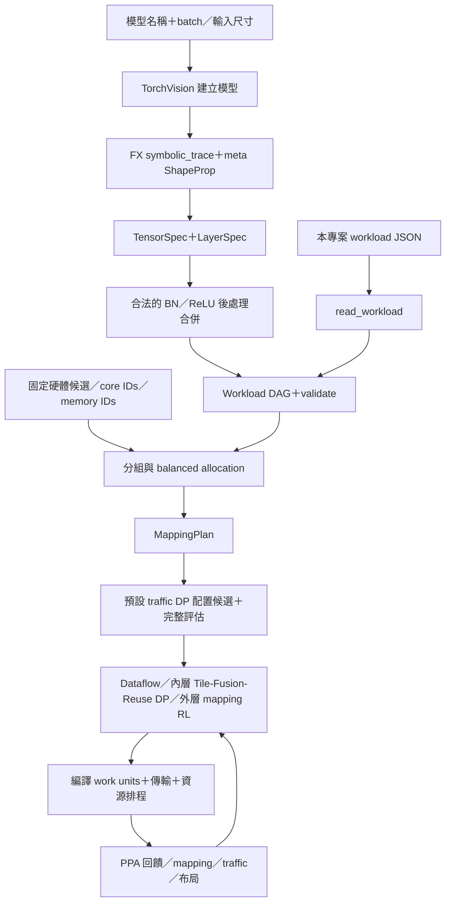
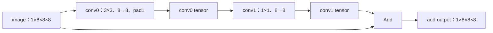

# 模型解析、DNN DAG 與 Layer Groups：目前實作與 RACE-RL 比較

核對日期：2026-10-27（Asia/Taipei）。本稿依桌面開發目錄的 INMIN V2 與本機 RACE-RL `b33f21c73ee241cd619e4a200455db9696c59e05` 查核；不沿用 2026-10-13 的舊比較結論。兩者來源與實際小型探測結果保存在 `output/frontend_walkthrough_20261027/`。沒有訓練策略或修改任一專案的架構程式。

**圖中的流程在我們程式裡對應兩個工作：把模型轉成可分析的描述，再決定算子如何分組與配置。傳遞的是形狀、依賴、計算量及配置資訊，不是把影像像素或中間 activation 數值交給 RL。** 2026-10-26 的 IO／L2 硬體 v0.2 仍是建議稿；本次探測使用目前已實作的固定 mesh profile，不能把探測當成該建議架構的驗證。

## 1. 從使用者輸入到 Workload

目前正式 GUI 主要輸入模型名稱、batch、偏好與限制。CLI 另有 `--workload`，可讀本專案格式的 JSON。不是任意 ONNX、任意 `.pt` 或任意「DNN description file」都已支援。



圖中的最後回饋箭頭表示搜尋反覆呼叫評估器。實際主流程在初始化階段也會先評估候選；內層 DP 啟用時，每個外層 mapping 候選還可能觸發多次內層評估。這不是每次只呼叫一次 oracle 的單一 RL 迴圈。

`hybrid/models.py::extract_model()` 的順序：

1. 用 `torchvision.models.<name>(weights=None).eval()` 建立模型，放在 **meta device**，不配置完整真實權重陣列。
2. `symbolic_trace()` 擷取運算與依賴；`ShapeProp()` 用指定形狀的 meta input 推導中間 tensor shapes。
3. 為 tensor 建 `TensorSpec`，為算子建 `LayerSpec`。Conv 的 kernel、stride、padding、dilation、groups、weight shape、MAC 數都明列。
4. 可合併單一消費者、形狀不變的 BN／ReLU 後處理，保留 `post_ops` 及向量操作成本。這是評估表示的合併，不是完成真實權重量化或推論準確率驗證。
5. 形成 `Workload` 並檢查拓樸順序、producer、Add 形狀與 Conv MAC 一致性。

| 物件 | 主要內容 | 後面誰使用 |
|---|---|---|
| TensorSpec | ID、NCHW shape、儲存 bits、producer；bytes 可由此計算 | 容量／生命週期／傳輸需求計算 |
| LayerSpec | 算子種類、input IDs、output ID、Conv 屬性、weight shape、MAC、post-ops | 分割枚舉、計算服務估計、work-unit 編譯 |
| Workload | tensors、layers、input/output IDs、batch；可查 producer／consumers | planner、RL features、compiler、evaluator |

例如有 `Add(A,B)`，兩條輸入邊都保留；不能把 residual DAG 攤平成只依賴前一層的鏈。`semantic_block` 是描述資訊，不表示 planner 一定按 ResNet block 分組。

## 2. 真實 ResNet-18 前端探測

本次實際擷取 `ResNet18, batch=1, input=224×224`：不合併後處理為 **69 個算子**，合併後為 **32 個評估算子**。

第一層解析結果：

```text
input x:          [1, 3, 224, 224]
Conv2d weights:   [64, 3, 7, 7]
stride/padding:   [2, 2] / [3, 3]
output relu:      [1, 64, 112, 112]
post_ops:         BatchNorm2d, ReLU
MAC/sample:       118,013,952
INT8 output size: 802,816 B = 784 KiB
```

這些 shape／MAC 是從模型與算子公式取得；1 B/activation 是目前加速器的 INT8 假設，不能解讀為 parser 已把 FP32 模型做完 PTQ。

預設每組最多 3 個算子時，第一組實際為：

```text
group0 = [conv1, maxpool, layer1_0_conv1], mode=spatial
```

所以目前的 group **不是自動等於一個完整 residual block**。第一個 Add 的兩個輸入仍為 `layer1_0_bn2` 與 `maxpool`；即使中間跨了 group，仍需要保存或寫回這條 skip-path tensor。

## 3. Graph Partition Engine 目前實際做什麼

輸入不只有 DNN DAG，還包含候選硬體的可用 mapping cores、memory IDs、頻寬／buffer、microbatch 大小等。輸出也不只有一份 layer-group 名單，而是 `MappingPlan`：

```text
MappingPlan
├─ groups: 每組有哪些 layer，spatial 或 temporal
├─ layer_mappings: 每個 layer 的 Part、ordered core IDs、DRAM selectors
├─ microbatch_size / memory_ids / collective
└─ fusion_stacks: 後續可選的跨層 tile/fusion 計畫
```

要區分兩種「partition」：

- **Graph grouping**：決定哪些完整算子屬於同一 layer group。
- **Tensor partition**：對一個 layer 的輸出沿 `(B,K,H,W)` 分成 shards。此處 K 是輸出通道，不是 GEMM 的輸入 reduction K。

`LayerMapping.chiplets` 這個舊欄位名稱容易誤解：值實際是 `compute:0/core:2` 這類 **mapping-core IDs**。目前每顆 die 有 4 個 mapping cores，各代表 4 PE；8 個 mapping cores 可以只分布在 2 顆 die，不能算成 8 顆 chiplets。

| 模式 | 實際行為 | 不應宣稱 |
|---|---|---|
| 預設 `traffic_dp` | `balanced_mapping` 先按拓樸順序每組最多 3 層，分配 core／Part；traffic DP 在既有 groups 上探索 Part／位置等候選，再由完整評估器選擇 | 不能說預設 DP 會全域搜尋最佳 group 邊界 |
| `balanced` | 同樣先分組，再依整數 SIMD 輪數、計算／記憶體服務與 buffer 壓力配置 cores | 不是平均給每層相同 core 數 |
| 可選 `beam` | 嘗試連續拓樸區段切點、spatial／temporal、合法 microbatch，估計剪枝後完整評估候選 | 有界搜尋，不是任意 DAG 全域最優圖切割 |

預設 traffic DP 不只看相鄰兩層，而會保留仍有未處理 consumer 的 producer frontier，處理 residual。對一般 DAG 採有界 beam；代理成本不是最後 PPA。後續 OP1–OP5 RL 改 partition、core 對應／配額及 DRAM selectors，**不直接改 layer-group 邊界**。

`spatial` group 中不同 layers 的 core 集合互斥，可讓不同 microbatches 在不同 stage 重疊；`temporal` 則共享 cores 並序列化其使用。依賴與資源仍要滿足，batch=1 不會憑空產生多筆 pipeline 的吞吐收益。

同 group 也不等於已融合成單一 kernel。前端 BN／ReLU 合併、LayerGroup、內層 `FusionStack` 是不同層級，應分別說明。

## 4. 可以手算、也已實際執行的 residual 範例

使用既有 `make_toy_workload(batch=1, channels=8, spatial=8)`，寫成 JSON 再經正式 `read_workload()` 讀回。它代表：



這裡以程式 ID `conv0`／`conv1` 命名兩個卷積。它們不是 ResNet 範例裡同名層的相同尺寸。

| 算子 | 輸入→輸出 | 權重 INT8 bytes | 工作量 |
|---|---|---:|---:|
| conv0 | image→conv0 | 8×8×3×3＝576 B | 8×8×8×8×3×3＝36,864 MAC |
| conv1 | conv0→conv1 | 8×8×1×1＝64 B | 8×8×8×8＝4,096 MAC |
| add | image、conv1→add | 0 | 512 次逐元素加法 |

每個 activation tensor 都是 512 B；卷積合計 **40,960 MAC**。解析器產出的依賴是 `image→conv0→conv1→add` 加上 `image→add`，不是執行一次神經推論所得到的 512 個數值。

### 實際配置結果

固定 2 顆 Compute chiplets、共 8 個 mapping cores，所有算子放在同一 spatial group。初始化經 traffic DP 選出：

| layer | `(B,K,H,W)` Part | ordered mapping cores |
|---|---|---|
| conv0 | (1,1,1,4) | die0/core0、die1/core0、die0/core1、die1/core1 |
| conv1 | (1,1,1,2) | die0/core2、die1/core2 |
| add | (1,1,1,2) | die0/core3、die1/core3 |

這是一次初始化探測的實際輸出，不是 RL 訓練後的最優解。core 集合互斥，權重來源為 memory:0；中間 tensor 依其 owner 分送給真正需要的 consumers。

以 conv0 的第一個 shard 為例，輸出 W=[0,2)，共有 `1×8×8×2＝128` 個元素。3×3、pad1 使它需要輸入 W=[0,3)，共 `1×8×8×3＝192 B`，而不是只讀同樣寬度的 128 B。第二個 shard 的輸出 W=[2,4)，需要輸入 W=[1,5)。這就是 halo，由 `required_input_regions()` 根據語意推導，不靠固定通信倍率猜測。

編譯器接著產出 `WorkUnit`，包含哪個 layer／microbatch／core、輸出 region、輸入 regions、weight region、MAC、vector ops 及 buffer 需求。通信模組將 producer ownership 與 consumer needs 相交，產生 `Transfer`（source、destinations、tensor region、bytes、依賴）。同 die 經共享 buffer／本地互連，跨 die 經 NoP；不是每條 DNN 邊都必然變成一條 D2D link。

### group 邊界造成的實際差別

本次保持 2 顆硬體與同一 toy，只改每組最多層數，不啟用內層 fusion 或 RL：

| grouping | DRAM logical read bytes | DRAM logical write bytes |
|---|---:|---:|
| `[conv0, conv1, add]` | 1,152 | 512 |
| `[conv0, conv1]`、`[add]` | 1,664 | 1,024 |

同一組的讀取為 `image 512＋weights 576＋64＝1152 B`，最終輸出寫回 512 B。把 Add 切到下一組後，conv1 的 512 B 輸出需跨 group 寫回，再被 Add 讀取，各多 512 B。Image 的 skip 依賴仍保留，不能在 conv0 讀完時就忘掉。

這是本程式「group 邊界物化到 DRAM」契約造成的結果，不是所有加速器天生必須如此。上述是 communication plan 的 **logical DRAM bytes**，不等於 NoP byte-hops、所有 SRAM 存取總量或實體 DDR bus transactions；halo 與 multicast 也要依口徑分開計。

## 5. 最後交給誰操作

1. Planner／traffic DP 提供初始 `MappingPlan`；dataflow tuner 與可選內層 DP 補上 tile、fusion、reuse 決策。
2. 外層 mapping RL 讀目前配置、工作量及已評估 PPA 的特徵，提出 OP1–OP5 修改；啟用內層 DP 時，外層候選仍會再做內層選擇。
3. `compile_mapping()` 把配置變成具體 `WorkUnit`；`build_communication()` 產生精確資料需求、傳輸與 lifetimes。
4. 片內服務、NoP／DRAM 服務與資源日曆 scheduler 得出分析式時間線及容量檢查；evaluator 組合 energy／latency／area／power，回饋搜尋。
5. report 輸出 mapping、traffic、timeline、布局及推薦顆數。這些是模擬／部署描述，**目前不是可直接交給真實晶片 Control Unit 執行的完整 ISA／binary**。

因此此段的核心產物是「可被編譯與評估的部署計畫」，不是分類 logits，也不是把 layer groups 直接送到 PE 執行。

## 6. 與目前本機 RACE-RL CNN 路徑比較

本機最新版已是 `race_gemmini_cnn_hierarchy_v1`。舊 `architecture.py`／H-only synthetic 路徑仍在，但需要明選歷史比較，不能當成其目前 CNN 主流程。

| 比較項目 | 我們目前 INMIN V2 | 目前 RACE-RL CNN |
|---|---|---|
| 前端輸入 | TorchVision 名稱＋batch；另可讀本專案 workload JSON | `from_torch(model, example)`；主流程 seeded FP32 TorchVision＋實際 example |
| parser 輸出 | Workload 的 TensorSpec／LayerSpec；meta shapes、INT8 儲存假設 | ImportedModel：Workload＋參數 arrays／manifest／FX graph；再 calibrate 與 execute_quantized |
| BN／ReLU | 合法後處理可併進前一算子的評估描述 | 前端保留獨立算子；量化／FP32 postprocessing 路徑明列 |
| Layer groups | 有 spatial／temporal groups，預設連續區段分組；可選 beam 探索 cuts | 沒有同義的 LayerGroup 切割階段；依完整 operator DAG 保留每層 plan |
| 誰決定軟體分割 | 初始化 planner／traffic DP＋外層 mapping RL＋可選內層 DP | 同一個 CNN Actor 選完整 design，聯合改顆數與相依算子的 plan |
| 分割內容 | 輸出 `(B,K,H,W)` factors＋ordered mapping-core ownership；tile 另列 | 每算子從 4 組 `(H,W,Cout,Kblock)` profile 選擇；Kblock 是片內 reduction |
| 位置與駐留 | ordered core groups、DRAM selectors、weight policy、內層 fusion／reuse | target＋single／round-robin、keep_output／keep_weights；GB peer 走 mesh |
| 多算子聯合操作 | spatial layer group 是資源／執行組織；OP3／OP4 可涉及多 layer | `coupled_scope` 由依賴圖 BFS 選局部相依算子，預設最多 2 個，打包成一次 action |
| 後端計時 | dependency／resource-calendar 排程，可有同 group microbatch pipeline | 每層取 node／DRAM／directed-link service 瓶頸，再加 layer barrier；沒有跨層 pipeline |

兩者都要從 output ownership 算 input demand／halo；不能說 RACE 只看層序或完全沒有資料重用。RACE 新版有 GB／LB／RF／ACC、有 output／weight residency，也支援 H／W／Cout。另一方面，其 coupled scope 不是執行群組：**「同時改兩個算子的設定」不等於「兩個算子同時 pipeline 執行或融合」**。

### 同一 toy 在 RACE-RL 如何走

本次另建立相同的 8-channel、8×8、兩 Conv＋Add PyTorch 模型，經 RACE 的 `from_torch → calibrate → execute_quantized`，成功產出 3 算子的 workload 與數值驗證報告。這是 seeded random weights、單個校準輸入的數值執行，不是資料集準確率驗證。

手動構造一個結構合法的 coupled transaction（不是訓練後 Actor 的取樣）：

```text
compute_count = 2
scope = [conv0, conv1]

conv0: profile (8,8,16,16), target die0, round-robin,
       keep_output=true, keep_weights=false
conv1: profile (8,16,32,32), target die1, round-robin,
       keep_output=true, keep_weights=true
add:   保留目前 plan
```

每層的真實輸出只有 8×8×8，以上兩組 profile 都各產生 **1 個有效輸出 tile**，不是宣告有 16／32 個實際輸出通道。尾端只取有效範圍，內部 padded arithmetic 另計。即使指定 2 顆 chiplet，也不保證這個小層會自動均分到兩顆。

該 action 完成後才由 `GemminiCNNModel` 解讀全部 plans、檢查容量，計層級存取、peer transfers 與 cycles；若提供合格 PPA 成本檔，環境才產生 PPA／reward。本次回饋確實記錄 `conv0→conv1` 的 512 B 從 die0 傳到 die1，以及 `conv1→add` 的 512 B 從 die1 傳回 die0。conv0 保留在 die0 GB 的輸出，當 conv1 放 die1 時必須透過 mesh 傳送，不能因兩者在同一 scope 就免費取得。

Actor 使用 operator／hardware／link 關係的 encoder，一次 forward 後選顆數、anchor 與 scope 內各算子的 profile／residency／layout／target；選擇期間沒有額外 PPA lookahead。完整 action 交環境後得到 reward 與新 observation；回合結束做 REINFORCE 更新，沒有 Critic。這與我們先 planner、再 mapping Actor-Critic、再內層 DP 的責任分工不同。

## 7. 可追查的程式與實測輸出

INMIN：

- [模型前端 models.py](C:/Users/user/Desktop/rapidchiplet/simplified_rapidchiplet/simple_rapidchiplet/hybrid/models.py:22)：extract_model。
- [Workload 資料結構與後處理合併](C:/Users/user/Desktop/rapidchiplet/simplified_rapidchiplet/simple_rapidchiplet/hybrid/workload.py:16)。
- [主入口 hybrid_dse.py](C:/Users/user/Desktop/rapidchiplet/simplified_rapidchiplet/hybrid_dse.py:82)：read_workload／prepare_plan／run_one。
- [分組與 allocator](C:/Users/user/Desktop/rapidchiplet/simplified_rapidchiplet/simple_rapidchiplet/hybrid/planner.py:156)、[可選 beam](C:/Users/user/Desktop/rapidchiplet/simplified_rapidchiplet/simple_rapidchiplet/hybrid/planner.py:244)。
- [Traffic DP](C:/Users/user/Desktop/rapidchiplet/simplified_rapidchiplet/simple_rapidchiplet/hybrid/traffic_planner.py:99)。
- [MappingPlan 與編譯](C:/Users/user/Desktop/rapidchiplet/simplified_rapidchiplet/simple_rapidchiplet/hybrid/mapping.py:100)、[通信](C:/Users/user/Desktop/rapidchiplet/simplified_rapidchiplet/simple_rapidchiplet/hybrid/communication.py)、[評估](C:/Users/user/Desktop/rapidchiplet/simplified_rapidchiplet/simple_rapidchiplet/hybrid/evaluator.py)、[排程](C:/Users/user/Desktop/rapidchiplet/simplified_rapidchiplet/simple_rapidchiplet/hybrid/scheduler.py)。

RACE（根目錄 `C:/Users/user/Documents/GitHub/20261012_RACE-RL`）：

- [from_torch](C:/Users/user/Documents/GitHub/20261012_RACE-RL/src/race_rl/frontend.py:51)。
- [prepare_model](C:/Users/user/Documents/GitHub/20261012_RACE-RL/src/race_rl/accelerators/cnn_search.py:80)。
- [量化與數值執行](C:/Users/user/Documents/GitHub/20261012_RACE-RL/src/race_rl/accelerators/cnn_quantization.py)。
- [coupled_scope／transaction／output_tiles](C:/Users/user/Documents/GitHub/20261012_RACE-RL/src/race_rl/accelerators/cnn_design.py:50)。
- [CNNPolicy](C:/Users/user/Documents/GitHub/20261012_RACE-RL/src/race_rl/accelerators/cnn_policy.py:8)、[環境](C:/Users/user/Documents/GitHub/20261012_RACE-RL/src/race_rl/accelerators/cnn_environment.py)。
- [GemminiCNNModel.evaluate](C:/Users/user/Documents/GitHub/20261012_RACE-RL/src/race_rl/accelerators/cnn_model.py:104)。
- [目前 CNN 路徑與界線](C:/Users/user/Documents/GitHub/20261012_RACE-RL/docs/research/cnn_hierarchy.md)。

實測資料在 `C:/Users/user/Desktop/rapidchiplet/output/frontend_walkthrough_20261027/`：

- `probe.py`：可重跑的小型探測。
- `probe_summary.json`：ResNet 擷取、toy grouping／流量、RACE transaction／量化資訊與來源 hashes。
- `toy_input_workload.json`：真正經 `read_workload` 讀回的輸入描述。
- `toy_initial_mapping.json`／`toy_selected_mapping.json`：實際初始化與 traffic DP 輸出。
- `toy_evaluation.json`／`toy_split_groups_evaluation.json`：work units、transfers、時間線與容量證據。
- `race_modelled_feedback.json`：相同 toy 的 RACE 層級存取／mesh／cycles 模型回饋，不含 PPA 成效宣稱。

本次只為解釋資料契約而跑小型探測；沒有做公平搜尋 benchmark，不據此判定哪個 RL 搜尋較好。
