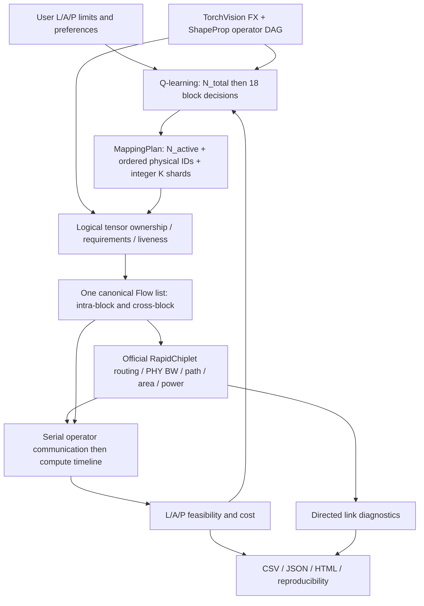

# Communication-aware reconstruction — Phase 2–10

日期：2026-10-04。使用者新授權解除 Phase 1.5 停止點，按修正版順序繼續。
Phase 1/1.5 的 audit / repair 文件保留作歷史 checkpoint；兩篇 PDF 作建模概念
參考，不把論文內容當操作授權。本次沒有 commit/push，沒有更改外部 RapidChiplet 原始碼。

## 完成的模型

Reference 為真實 TorchVision ResNet50 v1.5、batch=1、3×224×224、1000 classes、
FP32 activation/weight。FX symbolic_trace + ShapeProp 自動產生 175 算子，仍為
Stem + 16 Bottlenecks + Head 的 18 個 RL decisions。53 Conv、16 Add、4 projection
shortcuts；4,089,184,256 MACs；25,557,032 parameters / 102,228,128 weight bytes。
沒有使用手填 tensor dimensions，沒有下載 pretrained weights。



## 修改的 responsibilities

| 範圍 | 檔案（皆在 simplified_rapidchiplet，除 docs） | 結果 |
|---|---|---|
| Default heuristic removal | simple_rapidchiplet/mapping.py、dag_scheduler.py、e2e_latency.py、preference_dse.py | 刪 mapping efficiencies / hop factor；default只K，IC/spatial只明確 legacy calls |
| Exact graph | tensor_metadata.py、model_parser.py | FX shapes/deps、Conv/Linear MACs、group/stride/kernel、Add/shortcut、stable qualified callable targets |
| Integer mapping | mapping.py | N_total 與每 block ordered N_active IDs 分開；quotient/remainder K；operator MAC/weight shards |
| Ownership / traffic | tensor_ownership.py、traffic_model.py、flows.py | logical versions、required/missing slices、last-consumer residency、dedup、SRAM、canonical provenance |
| Native / serial evaluation | rapidchiplet_engine.py、network_context.py、physical_evaluator.py | 共用官方 route/BW/path；單一 serial timeline；跨 producer 同 consumer/kind 合併 service |
| Link diagnostics | network_diagnostics.py | directed load、zero-load links、hop-weighted traffic、explicit utilization basis |
| Bounded assignment | assignment_generator.py、configs/defaults.json | reuse/compact/comm-aware ordered candidates；physical boundary lower bound top K |
| RL / exhaustive | physical_dse.py、toy_model.py | preference-conditioned Q-state / TD max-Q、full cache identity、same legal candidate space、strict feasibility priority |
| CLI / artifacts | physical_cli.py、physical_report.py、run.py、preference_dse.py、scripts/run_demo.ps1 | 新預設；舊入口 --legacy；trace/CSV/JSON/HTML/version/hash snapshots |
| Validation | tests/test_physical_model.py、test_physical_search.py、test_physical_report.py、tools/validate_communication_aware.py | tensor/MAC/traffic/timeline/cache/native/permutation/reproducibility/exhaustive invariants |
| Documentation | COMMUNICATION_AWARE_DSE.md、README files、docs/reconstruction_progress.md | 目前操作方法、公式、legacy boundary、限制及測試證據 |

上述新增 module 路徑的共同前綴為 `simplified_rapidchiplet/simple_rapidchiplet/`。
既有 `models.json` 的六模型歷史 metadata 保留，沒有假稱它們已有 exact physical parser。

## 公式變更

每算子 output channels quotient/remainder 分片，不使用 fractional channels：

```text
MAC_shard = output positions × shard output channels × (Cin/groups) × Kh × Kw
T_compute = max(shard MAC × op_per_mac) / global compute rate
global compute rate = PE_rows × PE_cols × frequency × ops/PE/cycle × utilization
```

預設 global rate = 19.2×10^9 ops/s；同一 global utilization=0.75 對所有 candidates
一致，沒有 OC/IC/spatial 效率。一般 Conv 需要全 Cin；grouped/depthwise 根據 output
shard 的 relevant groups 推 input slices，包含 depthwise multiplier。

```text
Flow bytes = missing channel count × elements/channel × activation bytes/element
T_comm(event) = max_directed_link(load_bits / native BW) / frequency
             + max(native per-pair path cycles) / frequency
T_total = sum(T_compute) + sum(intra-block service) + sum(cross-block service)
FPS = 1e9 / T_total_ns  [output only]
```

每 consumer、每 kind 的 flows 聚合為 service event，不因不同 producer block 額外
重複 path service。兩種通信 breakdown 互斥，不把 transition 再當 network subset
重複加入。每 event 結束後才開始該算子的 compute；shortcut 分支也 global serial。
Rapid average ICI 是 diagnostic，legacy DAG scheduler 不參與新物理結果。

```text
hop-weighted bytes = sum(directed physical link load bytes)
link utilization = link bits / (serial E2E seconds × native bit/cycle × frequency)
cost = weighted normalized latency + area + power
reward = 1/(1+cost) if feasible, else -normalized constraint violation
```

SRAM invalid 增加一個 architecture feasibility violation；最後挑 best 也依 feasible、
violation、LAP 的順序。沒有 family/mode/FPS/hop/utilization bonus 或 congestion lambda。
Soft scales 是單顆 serial compute、configured max mesh 的 native area/power，hard limit
取代對應 scale。Q alpha=0.35、gamma=1、epsilon=0.25、topK=4 都在 config。
初始化每 N_total 一個 uniform 最大合法 active count episode，全部實際 evaluate /
同 reward 更新 Q；之後 epsilon-greedy，不保證 finite budget 勝過初始化 baseline。

## 保留的 assumptions / 實際限制

- Compute 目前只計 Conv/Linear MACs；BN/ReLU fused，Add/pool/flatten compute cost
  暫為零。Graph dependency 和它們造成的 ownership / transfer 仍保留。
- 收到的 logical version slices 保留到 last graph consumer，無 eviction。SRAM 計
  live activations + current operator weights，output 在 input retirement 前計入，
  fused versions 保守分開計 allocation，可能比實際 in-place allocation 更嚴格。
- EXTERNAL image=602,112 bytes、weights=102,228,128 bytes；mesh 沒有 DRAM/IO nodes，
  不假放 C0，外部 fetch latency/energy 不在 E2E 中。
- Native default BW=1929 bit/cycle，不使用 proxy 的 256 bit/cycle 冒充。Routing、
  per-pair path 和 BW 來自官方 backend；link-load service 是明列的 analytical
  bottleneck aggregation，沒有 BookSim queue/arbitration/multicast/overlap 模擬。
- Utilization 使用完整 serial inference 時間，因此 congested count 不能解讀成
  instantaneous queue congestion。沒有用 diagnostic utilization 再扣 reward。
- 官方 fixed chiplet power=20.5W 和 packaging link power 計所有 N_total，包含 inactive
  chiplets；相同 N_total 的 assignment 不會自動產生不同 dynamic energy。沒有編造係數。
- Candidates 依 first operator missing input bytes×Manhattan distance 的 boundary
  下界剪枝，不保證完整 block placement optimum。Ordered permutations 是不同 actions。
- Exhaustive 只針對最多 4 chiplets/3 blocks 的同一 bounded candidate space；超過 cap
  報錯。Toy gap=0 不代表 ResNet50 global optimum，64-evaluation RL 沒有最優保證。
- `.venv` 安裝隔離 torch 2.7.0+cpu / torchvision 0.22.0+cpu，沒有升級既有 packages。
  Cross-process fingerprint 排除 built-in repr 的記憶體位址，另有測試。

## 結果與重現

最終完整 **74 tests 通過，12.636s**；所有 final runs 的 source fingerprints 與
目前 workspace 相符，四個 ResNet profiles 的 model fingerprint 跨程序相同。
所有必需 artifacts 存在，JSON 為 strict / 無 NaN/Infinity，backends 均為官方。
HTML完成結構與檔案檢查；browser阻止local file protocol，沒有繞過或宣稱visual QA。

| Preference | Seed | Unique evaluations | N_total | Latency ms | Area mm² | Power W |
|---|---|---|---|---|---|---|
| Balanced | 20260915 | 64 | 2 | 213.356124 | 156.119659 | 42.0 |
| Latency | 20260916 | 64 | 9 | 49.808595 | 712.525909 | 196.5 |
| Area | 20260917 | 16 | 1 | 425.956693 | 77.4 | 20.5 |
| Power（≤50W） | 20260917 | 16 | 1 | 425.956693 | 77.4 | 20.5 |

最終 machine-readable evidence 在 `docs/communication_aware_validation.json`；完整
generated traces 在 `simplified_rapidchiplet/results/communication_aware_validation/`。
主報表為 `resnet50_balanced/report.html`，latency 對照為 `resnet50_latency/report.html`。
操作及輸出說明見 `simplified_rapidchiplet/COMMUNICATION_AWARE_DSE.md`。

實際 N=1/2/4/16 graph invariants：0/98/588/11,760 flows，官方 injected bits 完全等於
canonical bytes×8，逐筆驗證 producer ownership、consumer requirement、slice bytes、
dedup、MAC conservation 和 timeline single-count。沒有只對 mocked metadata 宣稱通過。

4-channel、2-chiplet、2-block toy 窮舉 17 designs；32-channel、4-chiplet、2-block toy
窮舉 394 designs，seed7/8/9 每次64 unique evaluations 都找到相同最低 cost，gap 0%。
完整 profile / seed / candidate counts / optimum 與 RL best 均在 JSON/CSV，沒有只報 reward。

目前 balanced 結果和 dynamic row-major / pure-exploration communication baseline
相同；64-budget 中尚未證明 Q-learning 比這兩個 baseline 更好，ablation 原樣保留。
這次交付完成 correctness / physical-cost reconstruction 與測試介面，不編造研究改善幅度。

## GPT coordination

已按使用者提供的 link 找到原 GPT 對話並完成第一次訊息與 review；採用其 grouped/
depthwise、logical version、last-consumer residency、serial single-count、ordered
state/cache、same legal space 六項 correctness gates。
第二次詳細 implementation/test payload 被 automatic approval review 拒絕，理由是
非公開 project details 的分享授權需要更明確；已提出具體 async 分享授權問題，
沒有重試或透過 browser 繞過。此限制不影響本地 Phase2–10 完成。
