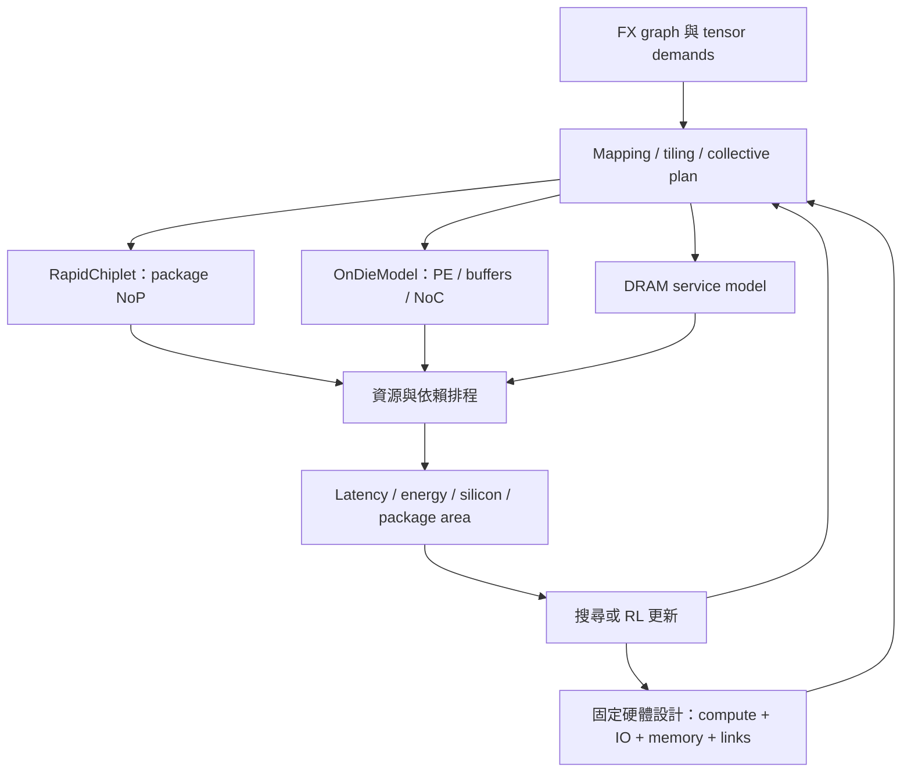

# INDM 與目前 RapidChiplet DSE 的架構審查

2026-10-04。此次交付是論文閱讀、程式審查、可重現診斷與實作方案；沒有修改 production evaluator、預設硬體設定或外部 RapidChiplet 原始碼。

結論：INDM 適合作為下一階段的架構參考。RapidChiplet 可以繼續擔任封裝層互連後端，但目前專案還不足以評估完整的 INDM 架構。優先順序應是硬體參數一致性與幾何合法性、I/O/DRAM 與 collective 通信、片內記憶體及 NoC，最後才擴大 topology/mapping 聯合搜尋。

## 1. 證據與範圍

- 已閱讀使用者提供的 INDM 全文 14 頁（印刷頁 1107–1120），核對 Fig. 3、Tables II–V、VII、延遲公式 (6)–(7)、Algorithm 1 與實驗比較。圖表另以渲染頁視覺檢查。
- 程式檢查涵蓋目前 `physical_*` 主路徑、FX parser、mapping、tensor ownership、traffic、assignment generator、network diagnostics、RapidChiplet adapter，以及本機原生引擎的 area/power/link/validation 實作。
- [診斷資料](C:/Users/user/Desktop/rapidchiplet/docs/indm_review_evidence.json) 記錄實驗數據、有效硬體設定、原始碼與外部輸入檔 SHA-256。
- [重現腳本](C:/Users/user/Desktop/rapidchiplet/simplified_rapidchiplet/tools/audit_indm_alignment.py) 僅建立記憶體中的不同設定並寫出審查 JSON，沒有覆寫原生輸入檔。
- 上一階段 74 個測試的通過紀錄，證明該版本的軟體不變量與整合結果；不等於已校準成真實晶片，也不等於完成 INDM 重現。本次另執行參數敏感度、重疊、PHY 衝突及異質 I/O 轉送診斷。

從 repo 根目錄重現：

```powershell
.\.venv\Scripts\python.exe -X utf8 simplified_rapidchiplet/tools/audit_indm_alignment.py
```

## 2. 論文真正做了哪些事

**Fig. 3 包含三個不同尺度。** Package 層每個 cluster 以 I/O die 連接至多四顆 compute dies 與一顆 DRAM，cluster 間由 I/O dies 互連；chiplet 層有共享 WL2/AL2/OL2 和連接 PEs 的 multi-ring；PE 層有 WL1/AL1/OL1、N_lane 條 vector-MAC，每條具有 N_size 個乘法器。把 package mesh 改成 ring，並不會建立論文的片內 multi-ring。

論文的 on-die ring 是順時針單向環，packet 不能任意跨環。設計動機是改善 L2 附近的流量集中、利用 weight/activation multicast，並降低 router/crossbar/buffer 與配線成本。這些成本及流量，現在的 evaluator 都沒有展開。

Package 的 I/O die 有 crossbar、GRS TX/RX、DDR PHY/controller。正文提到七組 GRS TX/RX，以及 DDR4 PHY/controller 在其 16 nm 參考條件下占用超過 10 mm²。實作時必須從每個 I/O 節點的實際連線推導 radix；不能把四顆 compute 加任意數量的鄰居都接到同一個固定埠數上。DRAM 使用 DDR 介面，也不能直接當成另一條相同 GRS link。

**INDM 同時考慮 mapping 與 memory hierarchy。** 它探索 P/Q 空間維度、K 輸出通道維度及混合方式，計入相鄰層 mapping 切換的通信；PE 內沿 C 維度做向量運算，但 PE/chiplet 間不分割 C，以避免跨節點 partial-sum accumulation。這支持目前先保留 K-only 的漸進策略，但若一直只做 K-only，無法充分檢驗論文各種 reuse pattern。

**其方法不是 RL。** 架構參數先做受面積限制的探索；mapping 使用 Algorithm 1 的 DP。其拓撲為設計時選定的硬體，不代表每執行一層就可以免費重新接線。可以借鏡「流量需求驅動網路設計」，再以 RL 做我們的聯合搜尋。

**論文的延遲模型已包含與目前不同的 overlap 假設。** 公式 (6) 用 compute time 作為 link 所需頻寬的時間基準，公式 (7) 用最忙 link 的 degrade ratio 決定是否 communication-bound。理想化形式相當於 `max(T_compute, max_link_bytes/BW)`；目前我們把通信與計算串行相加。不能僅替換 `sum` 為 `max`，還需要 tile、prefetch、buffer 容量及依賴成立。

Table IV/V 的主要參考條件如下；這些是論文設定，不是已校準的本專案硬體：

| 項目 | INDM 參考條件 | 目前本專案有效設定 |
|---|---|---|
| 資料精度 | activation/weight 8 bit，partial sum 24 bit | FP32 activation/weight；parser 強制每元素 4 B |
| 時脈 | PE/NoC 1 GHz | compute 與通信 cycles 換算共用 200 MHz |
| 每 die MAC 數 | cloud 配置 16 PEs × 16 lanes × 16 size = 4096 | 8×8 PE，每 PE 每 cycle 2 ops，等效 64 MAC/cycle |
| 16 compute dies 峰值 | 表列 128 TOPS | 0.4096 TOPS，乘全域 utilization 0.75 後為 0.3072 TOPS |
| Compute die 面積 | 面積限制下最佳值 2.83 mm²，限制 3 mm² | 原生描述檔 77.4 mm²/die |
| 記憶體 | WL1/AL1/OL1、WL2/AL2/OL2、tiling/reuse、DRAM | 每 die 16 MiB 的單一容量限制 |
| 跨 die link | 表列 100 Gb/s | 原生 bump 模型得到每方向 1929 bit/cycle，即 385.8 Gb/s @200 MHz |
| 片內 link | 表列 68 Gb/s | 沒有獨立 on-die 網路 |
| DRAM 頻寬 | edge/mobile/cloud 表列 37.5/150/600 Gb/s，隨 compute 數比例增長 | 未進入延遲及能耗 |
| 封裝 | organic substrate、GRS | 範例 packaging 宣告 active interposer；目前沒有 interposer-router 節點 |

論文的整體改善包含 architecture partition、memory、mapping、network 多項改動，不能全部歸因於 multi-ring。其 2.23% 平均預測誤差是與其相同 traces、相同架構下 gem5 的比較，不能當成本 evaluator 的誤差。

## 3. 目前程式哪些地方需要先處理

### A. 硬體描述沒有形成一致契約：已用實驗重現

位置：[config.py](C:/Users/user/Desktop/rapidchiplet/simplified_rapidchiplet/simple_rapidchiplet/config.py:8)、[_build_chiplets](C:/Users/user/Desktop/rapidchiplet/simplified_rapidchiplet/simple_rapidchiplet/rapidchiplet_engine.py:291)、[compute rate](C:/Users/user/Desktop/rapidchiplet/simplified_rapidchiplet/simple_rapidchiplet/physical_evaluator.py:74)。

Compute/SRAM 使用本地設定；area、固定 power、PHY/internal latency 和 bump-derived BW 使用另一份原生 JSON。現在 `_build_chiplets()` 原樣讀入描述檔，沒有把兩者統一。四顆 chiplets、兩個小 Conv 的敏感度實驗：

| 改動 | 計算延遲 ns | 面積 mm² | 功率 W | 解讀 |
|---|---:|---:|---:|---|
| 原始設定 | 213.333 | 314.901 | 86 | 面積欄為 package bounding box |
| PE rows 8 → 16 | 106.667 | 314.901 | 86 | 算力加倍卻沒有硬體成本變化 |
| SRAM 16 → 32 MiB | 213.333 | 314.901 | 86 | 容量改變卻沒有 SRAM 成本變化 |
| `rapidchiplet.chiplet_power_w` 20.5 → 1 | 213.333 | 314.901 | 86 | 此本地欄位未套用到原生 JSON |
| 本地 internal latency 3 → 300 cycles | 213.333 | 314.901 | 86 | 原生 path latency 仍為 34/62 cycles |

`network.link_bandwidth_bits_per_cycle` 是有註解標明的 proxy-only 設定，修改它不影響 official backend 屬於目前設計；問題在於需要在設定/輸出中明示有效來源，而不是讓使用者誤以為調到了真實 PHY。其他重複且未生效的 `rapidchiplet` scalar 應移除、標示或明確套用。

原生 `unit_count=8` 不能直接等同本地 64 PEs；它是網路端點抽象，需要定義對應關係。`tech_1` 也只是技術標籤，不代表已建立 16 nm MAC/SRAM/PHY 成本。

**建議：** 單一 HardwareSpec 同時產生 compute/memory cost 與原生 inputs；每個導出量記錄單位、來源、適用 precision/process/clock。更動 PE/SRAM/PHY 後，要更新成本或明確標為「不支援此硬體變更」，不能給出免費算力與免費容量。算力、NoC、NoP/PHY 時脈與有效傳輸率分開定義。

### B. 幾何/PHY 合法性目前不足：已重現錯誤可行解

位置：[placement](C:/Users/user/Desktop/rapidchiplet/simplified_rapidchiplet/simple_rapidchiplet/rapidchiplet_engine.py:299)、[停用原生 validation 的呼叫](C:/Users/user/Desktop/rapidchiplet/simplified_rapidchiplet/simple_rapidchiplet/rapidchiplet_engine.py:108)、[PHY 選擇](C:/Users/user/Desktop/rapidchiplet/simplified_rapidchiplet/simple_rapidchiplet/rapidchiplet_engine.py:327)。

把本地 `width_mm` 從 8.7977 改成 4，placement pitch 跟著縮小，但原生晶粒尺寸仍是 8.7977×8.7977。四顆晶粒出現六對重疊，實際 die 面積總和仍為 309.6 mm²，回報 package 面積卻縮至 167.644 mm²，`architecture_feasible` 仍為 true。這是可行性判定與輸入一致性漏洞，不是一般精度近似；目前搜尋尚未把 width 當 action，因此不表示既有預設解本身有重疊。

額外發現本機 RapidChiplet `validation.py` 的垂直不相交條件寫成 `t1 <= b2` / `t2 <= b1`，沒有偵測上述真實重疊。另外原生 validators 只印出錯誤，不丟 exception；in-memory inputs 又不會走檔案讀取時的自動驗證。因此僅改 `validate=True` 不足以解決，應在本專案新增會阻止評估的 AABB/port/routing 檢查。

在現有 mesh 加入 0–3 對角線，依方向自動挑 PHY 的方法會讓同一埠被使用兩次；原生 topology validator 有印出此錯誤。將來選 ring、cluster、long link 時，必須用明確的 port allocation，檢查唯一使用、radix、bump budget、connectivity、relay rules、route legality。Deadlock/VC 規則則是後续封包網路驗證的另一項要求。

### C. I/O cluster 最主要的流量來源還沒建模

位置：[EXTERNAL 直接入駐](C:/Users/user/Desktop/rapidchiplet/simplified_rapidchiplet/simple_rapidchiplet/tensor_ownership.py:72)、[SRAM 檢查](C:/Users/user/Desktop/rapidchiplet/simplified_rapidchiplet/simple_rapidchiplet/traffic_model.py:77)、[公開假設](C:/Users/user/Desktop/rapidchiplet/simplified_rapidchiplet/simple_rapidchiplet/physical_evaluator.py:23)。

目前已有正確的 tensor versions、primary ownership、跨 block/intra-block 資料需求與殘差 liveness，應保留。可是 image 和 weights 只記 byte 數；external image 到目的地直接視為可用，weights 只有容量成本。ResNet-50 的 102,228,128 B weights 沒有 DRAM fetch latency/energy，也沒有 final-output writeback、L2 refill/eviction 與 DDR contention。

因此 N=1 的片間通信是零，但不能解讀為整個加速器不需要資料搬移。也不能在這個模型上充分比較論文 I/O cluster 的 DRAM/reuse 優點。

目前 16 MiB 是「live activations + current weights」容量門檻；沒有 WL/AL/OL 分區、L1/L2 banks/ports/BW、雙緩衝與 tiling。超容量直接 reject 是已聲明的 baseline 限制，不代表該 mapping 在有 tiling 的真實硬體一定無法執行。

### D. 邏輯 all-gather 需求還不是 collective 執行計畫

位置：[required_transfers](C:/Users/user/Desktop/rapidchiplet/simplified_rapidchiplet/simple_rapidchiplet/tensor_ownership.py:66)、[communication event](C:/Users/user/Desktop/rapidchiplet/simplified_rapidchiplet/simple_rapidchiplet/e2e_latency.py:91)。

目前 missing slices 一律由 primary owner 對每個 consumer 個別傳送；收到的 replica 只用來減少該目的地的後續需求，不充當其他目的地的 forwarding source。這是可定義的 unicast baseline，並沒有 ring all-gather 的多階段轉送、分塊依賴或 multicast tree 上的共享傳輸。

建議分開 `TensorDemand` 與 `CommunicationPlan`：前者維持張量正確性，後者生成 unicast/ring-allgather/multicast 的實際 transfers，所有 link load/latency/energy 從這一份執行計畫推導。Logical delivered bytes、source-injected bytes、hop-weighted bytes 分別報告。不同 collective 的 source injection 與實際網路流量不必相同，不能以強制相同 raw bytes 當作正確性條件。

### E. Link utilization 的時間基準無法表示論文的 congestion pressure

位置：[network_diagnostics.py](C:/Users/user/Desktop/rapidchiplet/simplified_rapidchiplet/simple_rapidchiplet/network_diagnostics.py:5)。

目前 `utilization = link_bits / (整次 E2E 時間 × link_capacity)`，而整次時間已加上每個 event 的瓶頸服務時間。對任意 link l：每個 event 時間 `t_e >= B_e,l/C_l`，因此 `T >= sum_e(B_e,l)/C_l`，所以這個 utilization 原則上不會大於 1。`congested_link_count` 因而無法指出原本的計算需求會不會壓垮網路。

保留它作為 achieved average utilization，但另提供每個 phase 相對純 compute window 的 `required_BW/available_BW`、NoC/NoP/DRAM bottleneck 與 critical path。零 compute 的搬移階段獨立報告 service time，避免除以零。不要為了讓 RL 看見通信而硬加任意 congestion reward penalty。

目前完整延遲是 FX 順序下 compute + intra-block comm + cross-block comm；殘差兩分支也串行，Conv/Linear 以外的 Add/pool 等 compute 成本為零。這些是 baseline 假設；模型還不是 queue/VC/arbiter 或多資源 overlap 模擬器。

### F. 目前 area/power 不足以代表 INDM 的硬體 trade-off

位置：[area/power adapter](C:/Users/user/Desktop/rapidchiplet/simplified_rapidchiplet/simple_rapidchiplet/rapidchiplet_engine.py:156)。

`total_area_mm2` 使用原生 `total_interposer_area`，實際是所有 chiplets 的 bounding box。另有 total chiplet silicon area，但 physical metrics 沒有同樣完整地暴露。INDM 的 ≤3 mm² 限制是 compute die 面積；不能套到 package 面積欄。應分開 compute silicon、I/O silicon、memory silicon、total silicon、package footprint 與最大單 die 面積。

目前每個 die 固定 20.5 W，每條實體 link 固定 1 W；沒有 workload-dependent MAC/SRAM/DRAM/NoC energy，inactive dies 沒有 power gating。Mapping 在 N_total/topology 固定時無法透過資料重用改善 power 欄。因此需要 `energy_per_inference`，再導出 `average_power = energy / time`，另保留明確定義的 peak/TDP 約束。原生固定功率若已包含 dynamic cost，不能再不加區分地疊上操作能量。

建議能量模型以 MAC 次數、各層 buffer read/write、DRAM bits、每段實際網路傳輸與 leakage×elapsed time 組成。論文 Table III 的係數只能在相符 precision/process/操作與單位下作為參考；不能直接套進 FP32 baseline。

### G. 擴充 topology 前也要改搜尋表示

位置：[mesh 固定](C:/Users/user/Desktop/rapidchiplet/simplified_rapidchiplet/simple_rapidchiplet/physical_evaluator.py:64)、[assignment generator](C:/Users/user/Desktop/rapidchiplet/simplified_rapidchiplet/simple_rapidchiplet/assignment_generator.py:23)、[Q state](C:/Users/user/Desktop/rapidchiplet/simplified_rapidchiplet/simple_rapidchiplet/physical_dse.py:18)。

目前主路徑固定 `make_mesh()`。Candidate 排序只估第一個 operator 的 boundary traffic，距離用 grid Manhattan，沒有 whole-block demand、I/O hotspot、非 mesh 路由或 link BW 差異。top-k=4 有助控制規模，但可能提前刪掉後續有價值的 placement。這是 candidate quality 的限制，不是 tensor correctness 錯誤。

Q state 把完整 assignment history、累積時間與 live ownership 都納入，降低 aliasing 風險，但也讓有限 budget 很難多次造訪相同 state。在現有結果中，balanced 最佳解第 2 episode、latency 最佳解第 9 episode 就已出現，均位於前 16 次 uniform warm-start。balanced 的 Q-learning、dynamic-count fixed assignment、communication-aware random baseline 成本相同。

這些證據不代表 RL 永遠無效；目前尚未證明「學習」優於初始化與簡單搜尋。下一步應同時計算 uniform/random/greedy/beam 或小型 DP baseline、multiple seeds、達成相同品質所需 unique evaluations 與總 wall time。Toy exhaustive 的 0 gap 只對相同 bounded candidate space 成立，不是所有合法 assignment/topology 的 global optimum。

## 4. RapidChiplet 能繼續用到哪裡

原生引擎接受 chiplet/placement/topology/routing/traffic；其網路節點可包含不同 chiplet 描述與 interposer routers。官方另提供 [BookSim cycle-based simulation 接口](https://github.com/spcl/rapidchiplet#cycle-based-simulations-using-booksim)。

本次用 **兩顆 compute + 一顆 I/O + 一顆 memory** 的小型原生輸入驗證：`compute 0 → io 1 → compute 2` 與 `memory 3 → io 1 → compute 0` 的 area/link/latency/throughput 都成功算出，直接呼叫相關 validators 沒有錯誤。所有 die cost 都是複製範例值，這個 smoke test 只證明 API 可以表達與轉送，沒有證明真實 INDM 效能。

| 欲模擬項目 | 原生 RapidChiplet/本專案所需工作 |
|---|---|
| I/O die-based NoP | 可行；I/O 是具有尺寸、功率、PHY 與 relay=true 的實體 chiplet |
| DRAM die 對 compute 的封裝傳輸 | 可表達 endpoint/route；DDR/controller service、memory bandwidth 與流量來源另建模型 |
| I/O crossbar contention | 單一 internal latency 不夠；補 injection/ejection/crossbar 容量或進一步的 router 模擬 |
| Cluster 間 routing | 提供合法 routing table；論文 XY 的前提是 cluster mesh，可換其他合法策略後單獨驗證 |
| Compute die 內 multi-ring | 原生把 die 當網路節點，不會自動展開 PEs、L1/L2 與 multicast；新增獨立 on-die model |
| 單向 links/多環共享或平行 links | 本機原生實作把每條 link 展開成雙向、以節點對作 dict key；需擴充或使用獨立 NoC 模型 |
| 精確 queue、VC、arbitration | 現有 analytical backend 不提供；需適當 BookSim/gem5 等 trace 模擬驗證 |

本專案 adapter 比原生引擎更受限：placement 全部使用同一 compute 名稱、interposer_routers 為空，路由資料又把 typed node 縮成整數 ID，並拒絕中繼 irouter。I/O/memory 都用 chiplet endpoint 時可以保留統一 chiplet ID 空間；若納入 irouter，必須完整保留 typed IDs，避免不同節點種類的相同整數碰撞。

建議保留 RapidChiplet 做 **NoP**。另建 `OnDieModel` 負責 PE/L1/L2/multi-ring，再由同一 scheduler 合併 DRAM、NoP、NoC、compute。不要把 PEs 假裝成額外封裝 chiplets 直接累加面積，也不要把 I/O die 只當不含 DDR/PHY 面積成本的免費 interposer router。

## 5. 怎麼實作「topology follows communication」與 RL

合理的架構是兩層決策，外層選一個實體設計，內層在這個固定硬體上排 mapping。



**外層 architecture action，每個 design/episode 選一次：** N_compute、cluster size、compute-to-I/O placement、I/O topology template、合法 link/PHY budget、memory controllers/BW；後續才加入 PE/buffer/on-die topology 型號。先做有限個可製造模板，不立即開放任意加邊。N_compute、N_io、N_memory 與 graph node count 各自計數。

**內層 mapping action，每個 block/operator/tile 選擇：** active compute set、ordered K ownership、collective plan，後續新增 P/Q/K 切分及 buffer tiling。切換 mapping 可改變通信 pattern，但不表示封裝線路每層免費改變。若研究可重組網路，需明確定義可改的是 routing、開關或實體 link，並計入重組資源與時間。

通信需求與 topology 彼此依賴。可先從 baseline mapping 得到按 phase 分組的 demand graph，以它建立 cluster/拓撲候選；接著對每個拓撲重新最佳化 mapping，再迭代。只根據全模型總流量矩陣選一次拓撲，會遺漏互不重疊階段、峰值、residual liveness 與 memory access。

State 加入活躍 tensor ownership/residency、cluster 間 phase demand、NoC/NoP/DRAM bandwidth pressure、memory capacity/port budget，以及剩餘 graph 特徵。Candidate ranking 使用實際路由及頻寬，並保留不同 placement 家族的候選多樣性。不要透過「ring 比較有效率」之類的人工係數預設答案。

Reward 維持由同一 evaluator 的 latency/area/energy 或 power 偏好產生。Area/power 設計成本只能計一次；L/A/P 與 EDP 是不同目標，要明確選定與報告。能量與總延遲若作為全程乘積 EDP，不能把每層 EDP 相加就當成完全相同的目標。

INDM 的 DP 可當小型固定硬體 baseline。若成本具有 additive/node-transition 結構，latency/energy 適合 DP；全程 EDP 或跨多層 residency/residual dependencies，需要擴充 state、Pareto labels 或採用受限近似，不能直接照搬局部 recurrence 並宣稱全域最佳。

**為什麼 I/O cluster 不保證贏？** 現在 K-only 常產生 all-gather，I/O hub 也可能成為額外集中瓶頸；INDM 的好處有一部分來自 weight/activation reuse、DRAM 接入和片內 NoC。正確 evaluator 應允許某些工作負載 mesh 更好。相同 MAC/SRAM/精度/外部頻寬與完整 I/O 成本下的結果，才有研究意義。

## 6. 可實作順序與驗收條件

| 次序 | 工作與檔案邊界 | 完成條件 |
|---|---|---|
| 1 | HardwareSpec / validation；調整 config、native adapter、metrics | 明示有效參數來源；PE/SRAM 變更更新成本或拒絕；重疊、重複 PHY、斷路阻止評估；die/package area 分開；保留既有 baseline 可重現 |
| 2 | PackageGraph + MemoryModel；擴充 topology、placement、typed routing、external traffic | 4 compute + 1 IO + 1 DRAM 起步，再到 16 compute + 4 IO + 4 DRAM；手算 memory→IO→compute、跨 cluster 路徑及 bandwidth contention 一致 |
| 3 | TensorDemand → CommunicationPlan；collective、phase service、energy | 同一張量在 unicast/ring-allgather/multicast 後 consumer 數值範圍需求一致；差異出現在實際執行 traffic、latency、energy；不得重複計入共享路段 |
| 4 | OnDieModel + buffer/tiling；先 mesh，再 multi-ring | 能產生 WL2/AL2→PE、PE→OL2 traffic；P/Q/K reuse 正確；SRAM ports/BW 與雙緩衝限制生效；單向環不可跨環；成本含 MAC/SRAM/router/wire/PHY |
| 5 | Scheduler overlap 與代表性 trace 校準 | 先保留 serial baseline；再驗證 pipeline fill/drain、prefetch dependencies、resource contention；小案例比對 cycle model，分別報 NoC/NoP 誤差與適用範圍 |
| 6 | Hierarchical topology/mapping search 或 RL；改 physical_dse、assignment_generator、reports | 相同資源與多 seeds 比 uniform/random/greedy/beam/小型 DP；看 Pareto front、sample efficiency、wall time；明確 bounded search 範圍 |

步驟 2 的 memory access 先使用明確保守政策，如每次必要 weight/input load、final output writeback；有 tile 與 reuse 後再減少實際 DRAM access，不能默默把 weights 全部預載且不算容量/時間。不同 cluster 數量是否同時增加 DRAM BW，要明確設為實驗變因；論文比例增加的假設與固定 package memory BW 應分別測試。

步驟 4 可建立獨立的 `indm_reference` profile：16 PEs/die、16 lanes/PE、16 size/lane、1 GHz、INT8/INT24，以及論文表列 buffer/NoC/NoP 參數。這是 reference profile，仍須對 SRAM/PHY/IO 面積與 energy 來源做校準，不能只把面積常數改成 2.83 mm² 就稱為完整重現。FP32 baseline 另外保留；量化的數值準確率不在 shape-based timing 模型內自動獲得驗證。

最低有用里程碑是 **一致硬體 + memory-aware I/O cluster + 可解釋的通信執行計畫**，此時已能比較 package mesh 與 cluster。完整 multi-ring、空間 mapping 與 topology RL 接在其後，避免讓搜尋器最佳化尚不存在的物理效果。

## 7. 現有結果應如何解讀

| 現有 profile | compute ms | inter-chiplet comm ms | total ms | comm 占比 |
|---|---:|---:|---:|---:|
| balanced，2 compute dies | 212.9783 | 0.3778 | 213.3561 | 0.1771% |
| latency 偏好，9 compute dies | 48.9429 | 0.8657 | 49.8086 | 1.7381% |

在這兩個既有 mapping 的目前模型裡，即使消除所有已計入的片間通信，固定 compute 時間下也只能減少約上述比例的總延遲。這不是 topology 在真實晶片上的效益上限，也不是加入 DRAM/NoC 後的效益上限。它說明目前條件幾乎 compute-bound，直接放大 topology 搜尋空間可能只有很小訊號。

值得保留的基礎包括實際 FX graph、整數 shard/ownership、residual dependency、canonical data requirements、原生 route/BW 查詢及 reproducibility fingerprints。下一階段應在這些基礎上補足可被硬體驗證的成本和通信層級；現階段適合稱為「communication-aware mapping baseline」，尚不宜宣稱為完整 INDM hardware model 或已驗證的 topology-aware RL accelerator co-design。

參考來源：使用者提供的 INDM PDF（TCAD 43(4), pp. 1107–1120，DOI 10.1109/TCAD.2023.3332832）；[RapidChiplet 官方專案](https://github.com/spcl/rapidchiplet)；本機原生原始碼與輸入檔版本詳見 evidence JSON。
