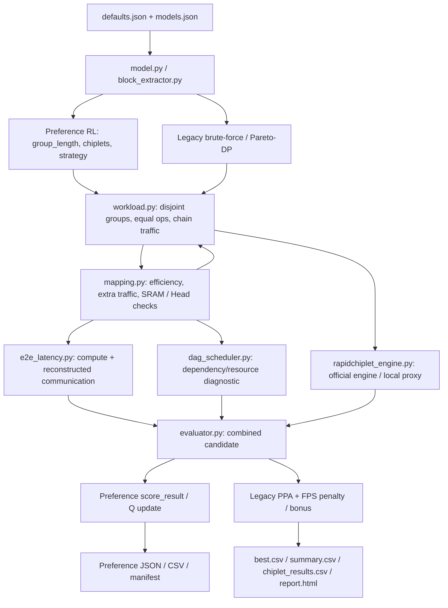

# Communication-aware mapping 重構：Phase 1 modeling audit

日期：2026-10-03（Asia/Taipei）。稽核對象是目前工作目錄，HEAD 為
`833fb2cc2971e4fdccb3c9b4e8429a88350b746d`，branch 為 `main`。

本輪完成 repository audit、基準測試與問題重現；尚未執行 Phase 2–10。
依使用者規格第 18、19、26 節，先提交目前架構、公式、修改範圍與資訊缺口，
確認架構後才開始修改 production evaluation。既有未提交修改均保留。
探針實測數據見 [modeling_audit_evidence.json](modeling_audit_evidence.json)。

## 1. 範圍與目前架構

Production 位於 `simplified_rapidchiplet/`。已閱讀核心 Python 模組、兩個 CLI、
設定、現有測試與主要說明文件，並檢查輔助工具的呼叫入口。
`audit_0917_*`、`audit_20260919/` 是歷史稽核/快照；`output/`、
`presentation_work/` 與簡報素材不是 production 模型來源。
沒有找到適用的 `AGENTS.md`。這份 audit 不宣稱逐一解析所有歷史二進位產物。

目前有兩條不同的搜尋/輸出流程，不能只修改其中一條：

| 流程 | 入口 | 搜尋 | Ranking / 輸出 |
|---|---|---|---|
| Legacy sweep | `run.py` | brute-force 或 Pareto-DP；physical count 從 1 掃到上限 | `evaluator._score_results()`；`report.write_outputs()` 產生 best/summary/chiplet_results CSV 與 HTML |
| Preference RL | `preference_dse.py` | `simple_rapidchiplet/preference_dse.py` 的 terminal-reward tabular Q-learning | `score_result()`；目前只產生 preference JSON、summary CSV、manifest |

共同前端是 `model.py` + `block_extractor.py`。共同 evaluator 整合 mapping、
DAG schedule、Batch=1 analytical E2E 與官方 RapidChiplet 或 local proxy。
目前 CLI 固定 mesh；底層 `topology.py`、部分測試與歷史圖表仍保留 tree。
本次不擴充 topology，也不把歷史 tree 比較帶入 production 搜尋。

模型 catalog 的目前表示：ResNet-50 為 18 semantic blocks；MobileNetV2、
EfficientNet-B0 各為 9 semantic blocks；ResNet-18 與兩個 ShuffleNet 為
6 個 legacy stages。這些都是人工填寫的 analytical metadata，尚無 ONNX/
PyTorch graph parser。ResNet-50 的 18 個 block 與既有語意邊界應保留。

## 2. 目前 data flow



圖中的 mapping/workload 雙向關係是建構時的函式呼叫與資料回填，不是遞迴。
E2E 與 Rapid 目前各自使用不同 traffic construction；這是需要修正的模型分歧。

## 3. OC/IC 與同類 heuristic 所在位置

以下檔案路徑相對於 `simplified_rapidchiplet/`：

| 檔案 / symbol | 目前行為 | 影響 |
|---|---|---|
| `simple_rapidchiplet/mapping.py:242`, `_compute_efficiency()` | OC 0.95、IC 0.85、spatial 0.90；另扣多 chiplet 效率 | E2E compute latency、DAG duration，間接影響 RL reward |
| `mapping.py:253`, `_extra_traffic_mb()` | 依 strategy 名稱決定 broadcast/reduction/halo 額外流量 | workload traffic、E2E communication、Rapid ICI/throughput、proxy power |
| `mapping.py`, `_partition_description()` | 只存 `fraction=1/N` 與 MB；沒有 channel range | 掩蓋 channel 不整除與真實 tensor ownership |
| `mapping.py`, `build_mapping_plan()` | group input 取 `max(first.input_mb, first.output_mb)` | input broadcast 可能取到錯誤大小；也影響 SRAM filter |
| `simple_rapidchiplet/e2e_latency.py:251` | throughput 乘 `compute_efficiency` | canonical E2E 與 compute-limited FPS |
| `simple_rapidchiplet/dag_scheduler.py:161` | duration 使用同一個效率 | makespan diagnostic |
| `dag_scheduler.py:208`, `_communication_cycles()` | 用 node_count.bit_length 推 hop factor | scheduler communication diagnostic；不是 actual route |
| `simple_rapidchiplet/preference_dse.py:184`, `legal_actions()` | parallel action 枚舉 OC/IC/spatial | IC 與 heuristic spatial 會進入預設 RL |
| `preference_dse.py`, `minimum_feasible_suffix()` | 同樣枚舉 OC/IC/spatial | feasibility mask / suffix resource reservation |
| `simple_rapidchiplet/workload.py` | 預設 parallel strategy 為 OC；理想均分 Ops、chain traffic、DP surrogate pruning | legacy candidate pool 不等於 physical mapping space |
| `simple_rapidchiplet/evaluator.py:30` | FPS penalty 0.75、bonus 0.15、bonus cap 0.25 | legacy final ranking 的人工 FPS 偏好 |
| `simple_rapidchiplet/report.py`、CLI、configs、READMEs、`PREFERENCE_BLOCK_DSE.md` | 顯示/接收 FPS constraint、描述 mapping efficiency | 使用者介面、結果語意與文件都需要同步 |
| `tests/test_evaluator.py` | 測試 OC/IC 差異與 FPS bonus，但未測 exact ownership | 舊測試不能證明新物理模型正確 |
| `tools/audit_0815_review.py` | 舊稽核工具仍有 OC/IC 對照 | 可保留歷史比較，不是 production 搜尋 |

未找到名稱為 `oc_bonus`、`ic_penalty`、`compact_bonus` 的獨立參數。
但 `compute_efficiency` 與多 chiplet 扣減已具有規格禁止的相同效果。

## 4. 現有實際公式及傳播路徑

令 N 為一個 group 的 chiplet count，I 為上述 group input MB，O 為
最後 block output MB。程式的「MB」實際乘 `1024²`，是 MiB 換算。

```text
e(single or N=1) = 1
e(OC,N)      = 0.95 - min(0.15, 0.01 * max(0,N-2))
e(IC,N)      = 0.85 - min(0.15, 0.01 * max(0,N-2))
e(spatial,N) = 0.90 - min(0.15, 0.01 * max(0,N-2))

extra_MB(OC)      = I * (N-1)
extra_MB(IC)      = O * (N-1)
extra_MB(spatial) = I * 0.25 * (N-1)

global_throughput = PE_rows * PE_cols * ops_per_PE_per_cycle * f * utilization
group_ops = sum(block.macs_g) * 1e9 * op_per_mac
group_compute_s = (group_ops/N) / (global_throughput * e(strategy,N))
```

`0.95/0.85/0.90`、`0.01/0.15` 與 halo factor `0.25` 未附文獻或量測來源。
相同 Ops 與硬體下，N=2 的 IC compute time 是 OC 的 `0.95/0.85` 倍。
這個差異來自手寫係數，不能當作 RL 學到 OC 優勢的證據。

效率沒有直接進入 mapping feasibility filter；filter 主要是 SRAM、Head
與 strategy 合法性。效率透過 E2E / FPS 改變結果與 reward。OC/IC traffic
公式也沒有 channel ownership：不整除、group 內 intermediate convolution、
residual tensor、partial-sum precision 都無法由這些公式準確表達。

## 5. IC reduction 現況

`build_mapping_plan()` 選 group 第一顆 chiplet 作 representative。
其他 N−1 顆各向 representative 傳 O MiB，kind 為
`partial_output_reduction`。`workload.py` 將這些 edges 加入原有 chain
traffic；`e2e_latency.py` 將同 group reduction 合併為一個通信 event。

沒有記錄 Cin shard、partial-sum tensor shape / accumulator precision、
reduction tree、Add workload 或 reduction buffer lifetime。這是體積估計，
不是實際 partial-sum reduction 模型。Phase 2 將 IC 移出 production/default
search；若保留，僅透過明確的 legacy 路徑進入歷史比較。

## 6. Mapping action、state、placement 與 candidate filtering

目前 RL action 是 `assign(group_length, chiplets, mapping_strategy)`。
state 包含 preference、next_block、used_chiplets、groups、model、constraints
與 mapping_strategies。沒有 tensor shapes、previous ownership、physical
N_total、assignment candidate 或 cumulative evaluated latency。

每次 action 將 `used_chiplets += action.chiplets`；下一 group 獲得下一段
連續 chiplet IDs。所有 groups 使用互不重疊的實體資源，physical count 是
group counts 的總和。尚未支援每個 block 在同一個 N_total architecture
上重用 chiplets。18 個 ResNet blocks 若各自單獨建立 group，就需要至少
18 顆，與目前上限 16 衝突，因而不能直接沿用 resource mask。

現有 `MappingPlan` 是整個 design 的 feasibility/groups/traffic_edges
容器；並非規格要求的 per-block plan。`MappingGroupResult` 只有 fractions，
沒有 K channel ranges、input_sources、output_owners 或可搜尋的全域 IDs。

`topology.py` 使用 `cols=ceil(sqrt(N))` 的 row-major mesh，少於完整方形
時保留不完整尾列。chiplet 寬度與 spacing 決定中心位置。assignment 固定
連續 ID，沒有 reuse/compact/communication-aware candidates。

目前主要過濾條件：

```text
memory_per_chiplet_MB = max(group_input_MB, group_output_MB) + group_weight_MB/N
memory_per_chiplet_MB <= configured SRAM
multi-chiplet group 不得使用 single
multi-chiplet group 不得包含 block_type == Head
contiguous coverage + remaining disjoint chiplet budget + suffix feasibility
```

SRAM 與 Head 規則是保守的現有假設，沒有根據 operator live tensors、
buffer reuse 或 FC partition 能力驗證。DP 則用 `max(group_ops/N)` 與
MAC 分界所落 stage 的 output traffic 作 Pareto pruning，沒有 exact
channel imbalance，也沒有實際 routes/link loads；它不是新 RL space 的
exhaustive oracle。

## 7. Current latency 與 FPS

canonical latency 是 `avg_latency_ns == e2e_latency_ns`：

```text
L_E2E = sum(group_compute_times) + sum(communication_event_service_times)
event_service = bottleneck_link_bits/(configured_BW * f) + max_path_cycles/f
path_cycles = 3 + 2*(internal+PHY) + relay_count*(internal+2*PHY)
              + sum(ceil(link_base + center_link_length*cycles_per_mm))
```

這是 serial analytical policy，不含 queue delay、DRAM stall 或
compute/communication overlap。未使用 BookSim。Rapid 官方 `latency.avg`
是 traffic-weighted path latency，另存 `rapid_avg_latency_ns`；目前官方
analytical latency 不隨 injection load 產生 queueing congestion delay。
不能宣稱它已包含 BookSim 級 congestion，也不應重複加入 congestion reward。

E2E 將相鄰 group 的 tensor 平分成 `source_count * destination_count` flows，
再另加 mapping broadcast/reduction events。DAG scheduler 只是 diagnostic，
其跨 group 通信使用任意 `1 + bit_length(N)/4` hop factor；E2E 仍以相鄰
group 處理，沒有把任意 DAG 或 Bottleneck 內 residual 真正展開成 ownership。

FPS 目前是 `min(compute_fps, Rapid_network_fps, pipeline_fps)`。
compute/pipeline ceiling 由最大 group/event time 反推；在目前 disjoint
pipeline 架構上使用。改成 chiplet reuse 後，必須根據資源排程重新推導，
不能原封不動沿用最大 block time。FPS 未必等於 `1/L_E2E`；新 report 要
分清 Batch=1 inverse-latency 與實際可支持的 throughput estimate。

## 8. Traffic generation 與 RapidChiplet integration

`workload._build_partition()` 先建立 `C_i -> C_(i+1)` chain traffic。
group 分界使用該 group 最後 block 的 output；group 內按累積 MAC 分界
所落 stage 的 output 估 volume。再加 `mapping_plan.traffic_edges`。
該 dict 單位為 bits/inference，直接送進官方 `traffic_by_chiplet`。

因此官方 engine 確實收到 workload traffic，但 traffic 尚非 tensor-derived。
E2E 使用另一套 all-to-all boundary flow 與 mapping event，兩個 evaluator
沒有共用同一批有 tensor identity 的 flows，可能重複/漏算。

官方 engine 從設定的外部 project 讀 chiplet、technology 與 packaging JSON，
adapter 在記憶體建 placement、mesh、SPLIF routing table，呼叫 area、power、
link_summary、latency、throughput。找不到 engine/import 時會自動 fallback。
目前未輸出 backend identity、per-link load、utilization、hop-weighted bytes。

## 9. Area / power 實際公式與限制

本機設定的官方 engine 可讀取並成功執行。來源：
`C:/Users/user/Downloads/rapidchiplet-main (2)/rapidchiplet-main/rapidchiplet.py`，
以及其 `inputs/chiplets/chiplets_example_experiment.json`、
`inputs/packagings/example_packaging.json`、`inputs/technologies/example_technologies.json`。
本輪沒有修改外部 engine 或其公式。

官方 path：

```text
chiplet_area = sum(placed chiplet dimensions.x * dimensions.y)
package_area = placement bounding width * bounding height
chiplet_power = sum(placed chiplet JSON power)
router_power = active interposer router count * packaging.power_irouter
adapter total_power = engine total_power + packaging-defined link_power
```

當前 chiplet JSON power = 20.5 W，packaging constant link power = 1 W/link，
沒有 interposer routers，故此配置為 `20.5*N_total + physical_link_count` W。
上游算出 link power 卻未放進 `power_summary.total_power`，adapter 的
`_compute_link_power()` 補回該既有 packaging value，不是 traffic coefficient。
固定 architecture 下官方 power 不隨 workload activity / traffic 改變。
packaging 設定 `is_active=true`，也不能僅依 README 就稱它是已驗證 passive
interposer 模型。

local proxy path 則是既有近似式：

```text
relative_load_i = ops_i/max(ops)
P_chiplets = sum(static_W + peak_dynamic_W*utilization*relative_load_i + 4*PHY_W)
P_links = sum(length*static_W_per_mm)
          + traffic_bits_per_inference*dynamic_pJ_per_bit*1e-12
            * min(config.target_fps, saturation_fps)
```

其中預設 0.5 pJ/bit 沒有可查來源，且不乘實際 route hop count；dynamic FPS
讀 cfg.target_fps，不一定等於 CLI target。這是既有 legacy proxy，不得將其
宣稱為 authoritative power。保留歷史模型時必須標示來源與限制；production
以官方 Rapid 模型為準，不新增 traffic-power 係數。

## 10. Reward 與 ranking

Preference RL：balanced 權重各 1/3；latency/area/power 偏好為 0.8/0.1/0.1
的排列。用使用者上限作 normalization；沒上限時 fallback scales 為 latency
1e6 ns，以及依 cfg 推導的 area/power scale。`custom` 尚未支援。

```text
cost = wL*latency_ratio + wA*area_ratio + wP*power_ratio
feasible reward = 1 - cost
infeasible reward = -1 - min(total_violation,1)
```

`min_fps` 是 hard constraint；architecture invalidity 也是 violation。
沒有獨立 OC bonus，但效率與 traffic 經 E2E 間接影響 reward。
best-candidate 比較先排 reward；當未給 hard limit、feasible cost > 3，
feasible reward 可以小於 -2，反而輸給 infeasible candidate。
因此文件宣稱 constraint-first 並非在所有 scale 下成立。新 ranking 必須
明確先比較 feasibility，再比較實際 normalized PPA cost；不靠 mapping bonus。

Legacy sweep 則用候選池最大 L/A/P 作 normalization，並加：

```text
PPA_score = weighted_LAP
            + 0.75*max(0,(target-achieved)/target)
            - 0.15*min(0.25,max(0,(achieved-target)/target))
```

新 production 須從 config、兩個 CLI、constraint_key、state、score、filter、
required-TOPS helper、report 与 demo 文件移除 target/min FPS input 及其
penalty/bonus；FPS 僅作結果。不是只隱藏 argparse 選項。

## 11. 參數來源分類

| 類別 | 目前項目 | 判定 / 後续處理 |
|---|---|---|
| Physically derived from configured inputs | mesh 座標/邊；bounding-box area；官方 PHY 幾何 link length；bump-derived BW；route path / load | 推導方式可追溯，但輸入仍屬 analytical assumptions |
| Model-derived（尚不完整） | block DAG 與 aggregate MAC/MB | JSON 提供，沒有 operator dimensions / precision 的證據鏈；不能稱 exact tensor-derived |
| Literature-based | 程式稱移植 0815 E2E 方法、Rapid-compatible routing | 0815 是先前專案參考，不等於已引用 paper；OC/IC 效率沒有文獻來源 |
| User/global hardware configuration | 8×8 PE、200 MHz、2 Ops/cycle、2 Ops/MAC、utilization 0.75、SRAM 16 MiB、max chiplets 16 | 可保留為所有 candidate 共用假設，集中 snapshot |
| Existing physical-model configuration | 外部 chiplet/packaging/technology JSON 的 power、geometry、bump、PHY 值 | 保存來源、內容/hash；固定 architecture power limitation 要顯示 |
| User preference / algorithm settings | L/A/P constraints、preference weights、seed、evaluation budget、Q α/γ/ε、DP top-K | 屬使用者或演算法選項，不是物理效率證據；集中設定並記錄 |
| Arbitrary heuristic | OC/IC/spatial bases、N penalty、halo 0.25、scheduler hop factor、ideal equal split、MAC-boundary chain traffic、FPS bonus/penalty | 從新 production 移除/替換；歷史比較須標示 legacy |
| Unverified legacy power approximation | proxy 0.5 pJ/bit、relative-load power、4-PHY constant | 不新增係數；不混同官方 power，保留時明示 approximation |
| Approximate feasibility rule | max(input,output)+weights/N、全 Head 不可平行化 | 根據 metadata / supported operation rules 重新驗證，不能假稱 exact physical proof |

設定中 `rapidchiplet.chiplet_power_w`、technology、fraction_power_bumps、
phy_fraction_bump_area 沒被 `_build_chiplets()` 套用，官方直接讀外部 JSON。
cfg.network BW/latency 主要控制 E2E/proxy，而非覆寫官方 packaging。必須
建立清楚的 authoritative source 與 effective assumptions，避免 snapshot
記錄的數值不是實際被評估的數值。

## 12. 已重現的 modeling correctness 問題

1. **RL cache 遺漏 mapping strategy**：`EvaluationOracle.evaluate()` 在
   `preference_dse.py:424` 使用 `key=state.groups`；budget/new-design 判斷
   也只看 groups。相同 groups 的 OC/IC 會共用結果。探針顯示第二次要求
   IC，卻回傳 OC plan、相同 object，unique_evaluations 僅 1。新 cache key
   必須包含 N_total、完整 per-block assignments/shards、effective config。
2. **E2E boundary 讀错 block**：`e2e_latency.py:120` 將下一 group 的
   `(start,end,parts)` 解包成 `(_start,next_start,...)`，把 end 當作 start。
   ResNet-18 groups `(0,3,2),(3,6,1)` 的正確 boundary 是 block 2 的 0.38
   MiB，實際用 block 5 的 0.01 MiB。
3. **送 Rapid 與算 E2E 的 traffic 不一致**：上述 OC 探針送 Rapid 的
   pairs 是 0→1、1→2；E2E boundary 使用 0→2、1→2，volume 又不同。
   新 traffic model 必須提供同一批帶 provenance 的通信 events。
4. **物理參數不一致**：E2E 用 256 bit/cycle，官方目前為 1929 bit/cycle；
   E2E 中心距離 8.947726979 mm，官方 PHY link 長 1.438397287 mm，且
   packaging latency function 與 cfg link_base 亦不同。不得把本地重建
   值直接稱為官方 per-flow evaluation。
5. **Residual 不完整**：Bottleneck 的 shortcut/Add 只存在 operator 字串與
   `branch_closed=true`，沒有兩個 Add input tensors 的 shape/dependency。
   支援 block-level DAG 不等於支援 block 內 residual communication。
6. **報表 count 語意錯置**：CSV `total_chiplets=row.available_chiplets`
   是搜尋上限 16；area/power 實際對 `selected_chiplets` 的 architecture
   計算。新輸出需分清 max_search_chiplets、N_total 與 N_active(t)。

## 13. 不足資訊與不能自行補出的數值

實作前需確定下列模型語意，或在輸入缺失時明確拒絕 physical evaluation：

- **Model variant**：ResNet-50 原始 stride convention 或 v1.5；BN folding、
  projection shortcut、pooling 與 FC 的精確定義。catalog 沒有 variant ID。
- **Precision**：activation、weight、accumulator 的 dtype/bytes；目前沒有
  precision 欄位。不可由 rounded MB 反推，更不能默認散落的 4 bytes。
- **Constituent ops**：每個 op 的 Hin/Win/Cin/Hout/Wout/Cout、kernel、stride、
  padding、groups、weight shape、tensor dependencies。現在只有字串。
- **Input/weight sources**：model input 初始由哪顆 chiplet/外部 memory 持有、
  weights 是否 preloaded；沒有 DRAM interface 或外部傳输 timing。不能
  隨便把 C0 指定為來源、捏造外部 bandwidth 或忽略後卻稱完整系統 latency。
- **Ops policy**：現有 conv/FC MAC 與 BN/Add/ReLU/Pool work 是否由同一 PE
  執行；沒有獨立 throughput 資料時需明示 coverage，不能硬加 arbitrary
  operator cost。
- **Tensor availability / buffers**：broadcast 後 replicas 是否留存、何時
  回收、SRAM live-set。若 main path 已取到 residual input，不能對同一
  tensor 無條件重複收費。
- **Network load time basis**：link load 可直接報 bytes/inference；utilization
  需要明確 event service window 或排程時間。不能用被移除的 target FPS
  當默認 required bandwidth。

本機官方 engine 已能執行，不需要另造 simulator。assignment beam K、
search seed 與 Q-learning settings 可作 configurable algorithm choices；
不為候選 family 新增 bonus，也不把它們當物理常數。

## 14. 預計修改與新增模組

所有下列修改均為後續計畫，本輪只新增 audit 文件及 evidence：

| 既有檔案 | 修改責任 |
|---|---|
| `configs/models.json`、`model.py`、`block_extractor.py` | operator/tensor metadata 與 validation；維持 semantic decision granularity |
| `configs/defaults.json`、`config.py` | 移除 FPS input；集中 precision、latency policy、search / candidate settings、global assumptions |
| `mapping.py` | 擴充現有 MappingPlan / compatibility，停用 IC/spatial production 與 mapping efficiency |
| `workload.py` | 從 per-block shards 產生 compute workloads/traffic，支援 N_total 的重用；隔離 legacy DP |
| `e2e_latency.py`、`dag_scheduler.py` | 共用物理 events 與 authoritative network outputs；移除錯誤 boundary / hop factor；明示 serial policy |
| `rapidchiplet_engine.py`、`routing.py` | 傳入 derived bytes→bits；回傳官方 routes/BW/latencies/link loads 與 backend provenance |
| `evaluator.py` | 整合 disjoint latency breakdown、N_total area/power、FPS output；移除 FPS score |
| `simple_rapidchiplet/preference_dse.py` | per-block active count/assignment action、ownership/state、完整 cache key、constraints-first PPA ranking、custom preference |
| `run.py`、`preference_dse.py`、`scripts/run_demo.ps1` | 新 input interface 與共同 production output；移除 target/min FPS |
| `report.py`、`combine_reports.py` | CSV/HTML 新欄位、policy/limits、legacy-result version 處理 |
| `tests/test_evaluator.py`、READMEs、`PREFERENCE_BLOCK_DSE.md` | 取代舊 default expectations、補 regression、更新入口與公式 |

預計新增到 `simple_rapidchiplet/`：

| 模組 | 責任 |
|---|---|
| `tensor_metadata.py` | TensorSpec / OperationSpec，precision 與 operator dependency validation |
| `workload_partition.py` | K 整數 channel shards；依真實 op dimensions 計算每顆 Ops/weights |
| `tensor_ownership.py` | 每個 tensor/channel range 的 owners/available replicas，含 residual lifetime |
| `traffic_model.py` | 從 requirements 與 missing local data 推 src/dst/bytes，保留 block/op/tensor provenance |
| `network_diagnostics.py` | 從官方 routes/BW/loads 提取診斷；不實作另一套 NoC evaluator |
| `assignment_generator.py` | deterministic bounded reuse/compact/communication-aware candidates；物理距離 lower bound |
| `exhaustive_baseline.py` | 小型 physical action space 的完整枚舉與 RL gap、ablation interfaces |

擴充既有 `mapping.py` 優先於建立第二個同名 MappingPlan。這個責任列表
允許共享小型 dataclasses，但不把全部邏輯塞回 evaluator。

## 15. Phase 1 → Phase 10 修改與驗證計畫

| Phase | 工作 / 公式變更 | 主要驗證 |
|---|---|---|
| 1 | Audit，不改 production 公式，不引入新 assumptions | 現有 tests + cache/boundary/official-config 探針 |
| 2 | IC/spatial 停用 production；刪 mapping efficiency 與 N-dependent penalty；移除 FPS constraint/bonus 接線 | default action 無 IC/spatial；compute 不再依 mode 名稱；CLI/score 不接收 FPS constraints |
| 3 | 固定 architecture N_total；每個 semantic block 決定 N_active 與 IDs；擴充 MappingPlan | 18 blocks 不改；N_active≤N_total；跨 block 可重用；area/power 仍含所有 physical chiplets |
| 4 | 補足 explicit tensor/operator metadata、precision、K ranges 與 owners；Ops 由 assigned channels 推導 | 可整除/不可整除 shard；exact Ops conservation；invalid metadata 拒絕；local owner 不傳輸 |
| 5 | 根據 input requirement 生成跨 block 與 block 內 flows，含 projection/identity shortcut→Add | hand-calculated 4-channel toy；1-chiplet zero traffic；determinism；residual locality / no duplicate transfer |
| 6 | 相同 flows 真正送官方 Rapid；E2E 用官方 route/BW/path outputs 聚合 serial event service | spy/interception 核對 traffic_by_chiplet、units、paths；修正已重現的 boundary/config divergence |
| 7 | per-link bytes、physical BW、明確 time basis 的 utilization、hop-weighted traffic | 手算 bottleneck；零流量/無 link case；diagnostics 不直接改 reward |
| 8 | bounded deterministic assignment candidates，K 從 config 讀；prune 依 bytes×distance bound | 同 logical shards 的不同 mesh IDs 改變 routed hop/load；candidate cap / reproducibility |
| 9 | RL action=(active_count,assignment_candidate)；state 含 tensors/prev owners/N_total/cumulative latency/spec；cache 更新 | legal masks、feasibility-first selection、seed、完整 key；≤4 chiplets/≤3 blocks exhaustive baseline + gap |
| 10 | 共用 CSV/HTML、trace、traffic、assumptions/config/seed snapshot、ablation exports | 小型 end-to-end CLI run；所有輸出 schema、latency sums、policy/limitations 與 provenance |

為了讓中間 phases 可測，Phase 3–8 可先建立非 default 的 physical primitives；
在 Phase 9 完成 RL 接線後才啟用完整新搜尋。每 phase 完成時記錄修改 files、
公式、assumptions 與 test command/result；不等全部重構後才跑測試。

新計算應以 `max_i(ops_on_chiplet[i]/global_throughput)` 表達每個可平行
operator 的 compute time；block 內按 op dependencies 聚合，保留 semantic
RL decision，不將 constituent ops 改成獨立 RL state。channel imbalance
自然進入 assigned Ops，不另乘 imbalance efficiency。

latency 欄位規約建議：`network_latency_ns` 只含 block 內通信，
`transition_latency_ns` 只含跨 block 通信，兩者集合互斥；serial policy 為
`total = compute + network + transition`。另外保留通信總計與 Rapid path
diagnostic。未實作或明確要求前，不啟用 overlap_bound。

最終至少產生：`best.csv`、`summary.csv`、`chiplet_results.csv`、
`report.html`、`mapping_trace.csv`、`transition_traffic.csv`、
`assumptions.json`、config/seed snapshot、per-link statistics，及小模型
`exhaustive_best`、`rl_best`、`gap_percent`。ablation 保留 fixed-count/
row-major、dynamic-count/fixed-assignment、communication-aware、RL 四種
介面；舊 OC/IC 模型只作標示清楚的 historical comparison。

## 16. Phase 1 驗證結果與本輪變更

執行目錄：`C:/Users/user/Desktop/rapidchiplet/simplified_rapidchiplet`。

```powershell
& 'C:\Users\user\.cache\codex-runtimes\codex-primary-runtime\dependencies\python\python.exe' -m unittest discover -s tests -v
```

結果：29 tests，3.450 秒，全部通過。missing-root 測試如預期觸發 local
proxy warning。`py -3` 指向無法啟動的本機 Python314，因此使用已存在的
bundled runtime；沒有安裝依賴或更動 runtime/config。

另外以目前公開建構函式、EvaluationOracle 與官方 link computation
函式執行 read-only probes，數據保存在 evidence。29 個舊 tests 通過只
代表舊行為基準穩定，不能推論 exact ownership / physical model 已正確。

本輪新增：`docs/modeling_audit.md`、`docs/modeling_audit_evidence.json`。
Production files 修改：無。公式變更：無。新物理 assumptions：無。
Phase 2–10 等待規格第 26 節要求的 architecture 確認，以及必要的 model
variant / precision / initial ownership 定義。
