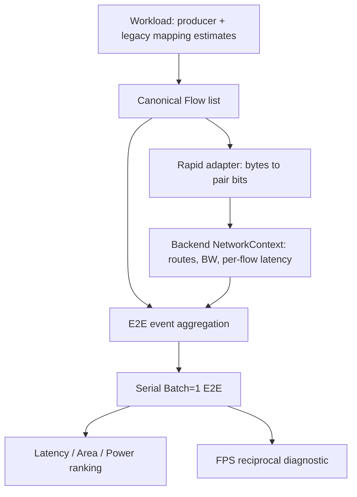

# Phase 1.5 correctness repair

日期：2026-10-03（Asia/Taipei）。本輪只完成使用者核准的 Phase 1.5：三個
correctness bugs 與 FPS constraint/reward cleanup。**Phase 2–10 尚未執行，
完成此報告後停止。** 原先 audit 及 before evidence 保留為歷史基準。

修正後數據、環境與驗證紀錄見 [phase_1_5_evidence.json](phase_1_5_evidence.json)；
修正前紀錄見 [modeling_audit.md](modeling_audit.md) 與
[modeling_audit_evidence.json](modeling_audit_evidence.json)。

本輪完成的是既有模型的正確性與一致性修復，**不是 exact K-partition /
tensor ownership 的物理模型**。現在仍使用原有 aggregate block MAC/MiB metadata，
不宣稱已取得真正 TorchVision operator graph。

## 1. 修改哪些 files

下列路徑相對於 repository root。

| 類別 | Files | 修改內容 |
|---|---|---|
| 新增 canonical representation | `simplified_rapidchiplet/simple_rapidchiplet/flows.py` | 單一 `Flow(tensor_id, src, dst, bytes)`；保存 event/group/block/legacy provenance，集中 bytes→bits aggregation |
| 新增 backend context | `simplified_rapidchiplet/simple_rapidchiplet/network_context.py` | 同一份 routes、per-link effective bandwidth、per-pair latency 與來源資訊 |
| Workload / network / E2E | `simplified_rapidchiplet/simple_rapidchiplet/workload.py`, `rapidchiplet_engine.py`, `e2e_latency.py` | 正確 producer boundary；共同 canonical flows；使用實際 backend bandwidth/path |
| Evaluation / RL | `simplified_rapidchiplet/simple_rapidchiplet/evaluator.py`, `preference_dse.py` | 完整 cache identity 與 budget novelty check；刪 FPS inputs、constraints、bonus/penalty；inverse-E2E diagnostic |
| Config | `simplified_rapidchiplet/configs/defaults.json`, `simplified_rapidchiplet/simple_rapidchiplet/config.py` | reference model/precision/EXTERNAL assumptions；移除 target FPS；明示原有 proxy power activity calibration |
| CLI / report | `simplified_rapidchiplet/run.py`, `simplified_rapidchiplet/preference_dse.py`, `simplified_rapidchiplet/simple_rapidchiplet/report.py`, `simplified_rapidchiplet/combine_reports.py` | 移除 FPS flags/status；輸出 canonical flows/context；舊結果 schema 明確拒絕 |
| Active analysis / audit compatibility | `simplified_rapidchiplet/tools/run_mesh_redefinition_analysis.py`, `simplified_rapidchiplet/tools/audit_0815_review.py` | analysis ranking 移除 FPS terms；audit 呼叫適配新 API/throughput diagnostic |
| Tests | `simplified_rapidchiplet/tests/test_correctness_repair.py`（新增）, `simplified_rapidchiplet/tests/test_evaluator.py` | 新增 17 個 regressions；保留並適配 26 個既有測試，刪除 3 個 obsolete FPS sizing tests |
| 說明文件 | `README.md`, `simplified_rapidchiplet/README.md`, `README_zh-TW.md`, `PREFERENCE_BLOCK_DSE.md` | 新語意、CLI 與 Phase 1.5 scope/limitations |
| 交付文件 | `docs/phase_1_5_correctness_repair.md`, `docs/phase_1_5_evidence.json` | 本報告及 before/after evidence |

表中省略前綴的 Python core files 都在 `simplified_rapidchiplet/simple_rapidchiplet/`；
省略前綴的 README / DSE 說明都在 `simplified_rapidchiplet/`。

工作目錄原先已有未提交修改；本輪保留它們。`configs/models.json` 與 Phase 1
audit 的 SHA-256 相同，本輪沒有重新填寫模型 MACs、shape 或 MiB 數值。
`mapping.py`、`dag_scheduler.py` 的 heuristic 公式沒有在本輪修改；外部官方
RapidChiplet、chiplet/packaging/technology JSON 也沒有修改。Smoke artifacts 位於
ignored `simplified_rapidchiplet/results/phase_1_5_validation_20261003/`。

## 2. 三個 correctness bugs 的 root cause

| Bug | Root cause | 修復 |
|---|---|---|
| RL cache alias | cache 與 new-candidate 判斷只使用 `state.groups`，遺漏 `mapping_strategies`；相同 group 的 IC 請求可能回傳 OC 結果，budget 也漏計 | key 使用完整 immutable state、model、config、profile、chiplet budget，以及官方輸入檔內容 fingerprint；evaluate、Q novelty 和 random fallback 共用同一個 key |
| Wrong E2E boundary tensor | 下一 group 的 `(start,end,parts)` 被解包為 `(_start,next_start,...)`，誤把下一 group 的 `end` 當成分界 start，讀到下游最後 block output | boundary 在 workload 中只建立一次：`producer = model.blocks[previous_group.end - 1]`；E2E 不再自行選 tensor |
| Traffic / BW inconsistency | Rapid 收到 chain + mapping traffic，E2E 自行建立另一組 all-to-all events；E2E 另用本地 BW、中心距離与 PHY 假設重建官方 path | 所有 evaluator 使用 canonical Flow list；Rapid 將其依 pair 合併為 bits，E2E 依 event 合併同一批 flows；E2E 的 routes/BW/path latency 由所選 backend 回傳 |

官方 backend 的 effective BW 是官方 chiplet/packaging 輸入推導出的每條
directed-link BW。Local proxy backend 的 effective BW 才是 `cfg.network`。
因此相同 candidate 的兩條評估路徑有同一個 authoritative bandwidth source，
不再拿 proxy knob 假稱官方 bandwidth。不同 backend 的數值本來就可能不同，
JSON 明確標示來源。

## 3. 修正前 / 後公式與 data flow

### Cache

```text
Before: key = state.groups
After:  key = (model, cfg, profile, max_chiplets, complete_state,
               official_input_content_fingerprint)
```

`complete_state` 已含 groups、mapping strategies、used chiplets、preference、
constraints 與 model ID。Fingerprint 包含設定的 chiplet、packaging、technology
JSON，以及官方 `rapidchiplet.py` / `helpers.py` 的 SHA-256。尚不存在的未來
assignment/shard variables 留待 Phase 4 / 8 / 9 加入，不宣稱已建模。

### Canonical boundary / injection

```text
producer = blocks[previous_group.end - 1]
tensor_id = producer.name + ':output'
boundary_bytes = producer.output_mb * 1024**2
bytes_per_pair = boundary_bytes / (source_count * destination_count)

Rapid input[(src,dst)] = sum(flow.bytes * 8 for that pair)
injected_bytes = sum(flow.bytes)
E2E event bytes = sum(bytes of its canonical flow_indices)
```

這裡 `output_mb` 是既有欄位名稱，實際單位為 MiB。保留原 E2E 的 equal-pair
volume policy，只修正來源及一致性；它**不是 ownership-derived all-gather**。
小數 bytes 是原有 rounded MiB metadata 的結果，exact integer bytes 留待
Phase 3–5。多個 tensor 共用 pair 時只在 Rapid 格式層合併；原始 tensor IDs
與每筆 flow 的 bytes 仍保存在 `canonical_flows`，可用 event 的 `flow_indices`
逐筆追查。



初始 activation 的來源已記錄為 `EXTERNAL`。開始於 block 0 的 legacy
`input_broadcast` / `spatial_halo_exchange` 不送進 compute mesh，以免捏造 C0
為 host input owner。Weights 本來就沒有 mesh flows；目前也記錄為 EXTERNAL。
`mapping_plan.traffic_edges` 仍是 legacy estimated metadata，可能包含被排除的
初始 input edge；它不是 authoritative injection，應讀 `canonical_flows`。

### Communication / compute / FPS

```text
load_bits(e, link) = sum(flow.bytes * 8 for flows of event e routed on link)
serialization(e) = max_link(load_bits(e,link) / BW(link)) / frequency
path_delay(e) = max_flow(backend_latency_cycles(src,dst)) / frequency
service(e) = serialization(e) + path_delay(e)

compute(g) = (group_ops / parts) / (global_compute_rate * legacy_efficiency)
E2E_seconds = sum_g(compute(g)) + sum_e(service(e))
FPS = 1 / E2E_seconds
```

`legacy_efficiency` 明確保留至 Phase 2。Policy 是 serial；本輪沒有引入 queueing、
overlap、packet-level 或 cycle-accurate congestion simulation。官方 per-flow path
latency 直接使用官方 `compute_latency()` 與其 PHY/packaging intermediates；
Rapid global traffic-weighted average 另存為 `rapid_avg_latency_ns`，不代替 E2E。

FPS 舊公式為 compute/network/pipeline ceilings 的最小值；legacy PPA 還加
`0.75 * miss_penalty - 0.15 * excess_bonus`（bonus cap 0.25），RL profile 可含
`min_fps` constraint。修正後 PPA score 只含 normalized L/A/P weighted cost；
RL reward 只保留 L/A/P preference、其 user constraints 及 architecture validity。
FPS 不再進入 selection、tie-break、action mask 或 reward。

### Before / after 重現

與 accepted audit 相同：ResNet-18，groups `(0,3,2),(3,6,1)`，官方 backend。

| 項目 | Before | After |
|---|---|---|
| OC→IC cache probe | 相同 object，unique=1，IC 收到 OC mapping | 不同 object，unique=2，IC 收到 IC mapping |
| Boundary producer | downstream `fc` output 0.01 MiB | `layer2` output 0.38 MiB |
| E2E boundary bytes | 10,485.76 | 398,458.88 |
| OC Rapid pairs | 0→1、1→2，與 E2E 不同 | 0→2、1→2，各 199,229.44 B，與 E2E 相同 |
| E2E effective BW | local 256 bit/cycle | official 1929 bit/cycle |
| OC communication ns | 503,513.8 | 8,572.496215655781 |
| OC compute ns | 140,241,228.07017544 | 140,241,228.07017544（本輪未移除效率） |

Communication 的變化包含修正 tensor、traffic pairs、EXTERNAL 排除及 backend
BW/path，不能將差值解讀為任何 mapping 的物理優勢。詳細每筆 flow、event
及 IC 對照皆保存在 evidence。

## 4. 新增哪些 tests

`tests/test_correctness_repair.py` 新增 17 個 regressions：

| Tests | 驗證 |
|---|---|
| `test_boundary_uses_actual_producer_not_consumer_tensor` | toy A output `(1,4,2,2)` = 64 B、B output `(1,2,1,1)` = 8 B；A→B 使用 A 的 64 B，兩筆各 32 B |
| `test_mapping_strategy_candidates_do_not_alias_in_rl_cache` | 相同 architecture 的 OC/IC 分開評估；重複同一 candidate cache hit |
| `test_changed_hardware_cannot_return_old_cached_latency` | global compute config 變更不能取得舊結果 |
| `test_cache_fingerprints_official_input_contents` | packaging file 同一路徑、內容變更時 key 改變 |
| `test_q_learning_budget_counts_mapping_distinct_candidates` | 最小搜尋中 single/OC/IC/spatial 共四種 candidate 都計入 budget |
| `test_every_canonical_flow_is_counted_once_in_e2e` | E2E event indices 完整、無重複，canonical / pair aggregation / event bytes 守恆 |
| `test_tensor_provenance_survives_pair_aggregation` | 同 pair 的不同 tensors 保留 identity；合併 bits 正確 |
| `test_serialization_uses_per_link_backend_bandwidth` | 較少 bytes 的慢 link 仍可成為真正 serialization bottleneck |
| `test_single_chiplet_has_no_canonical_network_flows` | 單 chiplet network traffic / communication = 0 |
| `test_external_input_is_not_faked_as_chiplet_zero_broadcast` | 初始 EXTERNAL input 不建立虛構 C0 mesh transfer |
| `test_fps_is_inverse_e2e_and_cannot_change_reward_or_ppa` | FPS reciprocal 正確；單獨改 FPS 不改 PPA/reward |
| `test_obsolete_fps_constraints_rejected_by_api_and_config` | 舊 API/config FPS constraint 明確拒絕 |
| `test_obsolete_fps_flags_rejected_before_search` | 兩個 CLI 的舊 FPS flags 在 search 前拒絕 |
| `test_report_has_diagnostic_fps_and_network_provenance` | CSV / HTML diagnostic 欄位與 provenance，沒有 FPS targets/bonus/penalty |
| `test_reference_config_records_requested_baseline` | baseline variant、FP32 4 B/element、EXTERNAL 配置 |
| `test_official_adapter_injected_bytes_and_e2e_share_flows` | 攔截實際官方 call；pairs、bytes、effective BW 與 E2E 一致；改 proxy BW 不改官方結果 |
| `test_scheduler_communication_estimate_does_not_change_search_metrics` | 將 scheduler communication 放大仍不改 canonical E2E/FPS/validity/PPA/reward，只改 schedule diagnostic |

Toy shapes 僅是 regression fixture，沒有將人工 ResNet operator dimensions 填入
production。17 個 tests 不等於 future ownership engine 已經驗證。

## 5. 全部 tests 是否通過

Production suite：**43 tests，全部通過；0 failures、0 errors、0 skipped，9.451 秒**。
其中保留既有 26 tests，加本輪 17 tests。實際 official-engine regression 有執行，
不是 skip。舊 29 tests 中 3 個 target-FPS sizing tests 隨已移除 API 一起刪除。
歷史 `audit_0917_snapshot/` 的 tests 屬舊版本，未作為新 production suite 執行。

執行目錄 `simplified_rapidchiplet/`：

```powershell
& 'C:\Users\user\.cache\codex-runtimes\codex-primary-runtime\dependencies\python\python.exe' -m unittest discover -s tests -v
```

其他已完成檢查：

- core、tests、兩個 CLI、combined report 及兩個適配 tools 的 `compileall`。
- ResNet-18 bounded sweep：max chiplets 4，15 candidates，CSV/JSON/HTML 成功。
- ResNet-50 Q-learning smoke：budget 2、seed 20261003，18 semantic blocks，2 unique evaluations，JSON/CSV/manifest 成功。
- Smoke 結果的 FPS reciprocal、canonical/event injected bytes、無 obsolete FPS fields。
- Combined report 使用新 schema 成功；pre-1.5 schema 被明確拒絕。
- `run_mesh_redefinition_analysis.py --help` 成功；沒有重跑高成本完整 sensitivity analysis。
- `git diff --check` 通過。

這些是 regression 與 bounded smoke，不是整個 DSE 空間的 exhaustive validation，
也不是已完成 Phase 3–10 的證據。

## 6. FPS bonus / penalty / constraint 還剩哪些 references

**Production evaluation / search / CLI / config / report 沒有可用的 FPS input
constraint、bonus 或 penalty。** `--target-fps`、`--min-fps`、`target_fps` config
和 API parameters 明確拒絕，避免舊操作被默默忽略。

保留的 references 分成以下類別：

| 位置 | 意義 / 是否影響 search |
|---|---|
| `evaluator.py: achieved_fps`, `performance_per_w`；CSV/HTML/CLI output | reciprocal-E2E diagnostics；ranking 不讀取 |
| `rapidchiplet_engine.py: network_limited_fps`、`rapid_proxy.py: saturation_fps` | network saturation rate 的既有內部計算，不是 achieved FPS 或 constraint；engine rate 不送進 reward |
| `rapidchiplet_engine.py: _local_link_power()` | 既有 proxy dynamic power 使用 reference activity rate 並受 network saturation 限制；原 15 Hz calibration 集中為 `power.proxy_reference_activity_hz=15`，與 report FPS 無關，沒有新增能量係數 |
| `tools/run_mesh_redefinition_analysis.py: RANK_TARGETS` 的 `achieved_fps` | 只供事後 rank-correlation diagnostic；design selection 使用 L/A/P |
| `tests/test_correctness_repair.py` | 舊名稱只用於 rejection / invariance regressions |
| `docs/modeling_audit*`, 本報告 before comparison | 保存修正前證據與 migration 說明 |
| `tools/make_integrated_search_check_slide.py`, `make_ppt_report_pngs.py`, `make_shufflenet_500fps_slides.py`, `make_simplified_architecture_diagram.py` | 歷史簡報生成器，仍有 target/status/15 or 500 FPS 字串，只適用舊 artifacts；不供本輪 production search 使用 |
| 歷史 snapshots、slides、generated results | 沒有刪除或重寫研究歷史 |

歷史簡報生成器未改成新 schema；不能用它們製作本輪正式新報告。新 combined
report 不讀取 pre-1.5 結果，需重新執行搜尋產生新結果。

## 7. OC / IC / spatial heuristic 還剩哪些 references

依「只執行 Phase 1.5」的明確 scope，本輪沒有提前移除 Phase 2 heuristics。
**預設 RL 仍能選 IC/spatial；它們並非 disabled_by_default。** 以下仍會影響
目前結果，不能把 Phase 1.5 稱為已移除 mapping bias：

| 位置 | 保留公式 / 行為 | 影響 |
|---|---|---|
| `mapping.py: _compute_efficiency()` | OC 0.95、IC 0.85、spatial 0.90，另扣 `min(0.15, 0.01*max(0,N-2))` | E2E compute、schedule duration、latency/reward |
| `mapping.py: _extra_traffic_mb()` | OC `I*(N-1)`、IC `O*(N-1)`、spatial `I*0.25*(N-1)` | legacy traffic estimates，canonical flows 仍會沿用非初始 group 的估計 |
| `mapping.py: build_mapping_plan()` | `input_mb=max(first.input_mb,first.output_mb)`；representative broadcast/reduction；`fraction=1/N` | 尚無真實 requirements/channel ranges；SRAM / traffic approximation |
| `e2e_latency.py: _group_compute_time_s()` | `group_ops/N` 後除以 efficiency-adjusted throughput | 尚非 integer per-operator MAC workload |
| `dag_scheduler.py` | 同一 efficiency 與 artificial hop estimate | diagnostic schedule |
| `preference_dse.py: legal_actions()` / `minimum_feasible_suffix()` | parallel strategies 仍枚舉 OC、IC、spatial | production RL action space |
| `workload.py: _internal_group_traffic_bits()` / DP pruning | 累積 MAC 分界落到 stage，再讀其 output MiB | 舊 candidate-generation surrogate，未改成 tensor-derived pruning |
| READMEs、tests、manifest、historical audit tools | legacy mapping 名稱、公式、對照 | 有 scope 標示，待 Phase 2 / 後續更新 |

`defaults.json` 中 `link_latency_cycles_per_mm=0.25` 與
`phy_fraction_bump_area=0.25` 是不同設定，不是 spatial halo coefficient。
本輪沒有新增 `all_gather_factor`、K efficiency、imbalance efficiency 或 mapping
bonus。EXTERNAL initial input 排除只是 endpoint correctness repair，並不表示
spatial halo 的 0.25 已全面停用。

## 8. Scheduler artificial hop factor 的角色與影響

分類：**LEGACY_HEURISTIC**。位置：`dag_scheduler.py: _communication_cycles()`。

```text
hop_factor = 1                         if N_total <= 1
             1 + N_total.bit_length()/4 otherwise

communication_cycles = output_bytes*8/proxy_BW*hop_factor
                       + proxy_link_base_cycles + configured_PHY_cycles
```

例如 N_total=4 時 factor=1.75；它不等於 Manhattan hops、routing path 長度、
PHY distance 或官方 per-flow latency。只有跨 group predecessor→consumer 的
scheduler dependency estimate 使用它；same-group dependency communication=0。

目前影響 task start/finish、incoming communication、schedule makespan、
critical path diagnostic，以及 `schedule_latency_ns`。它**不影響 canonical
E2E/PPA latency、inverse-E2E FPS、area/power、architecture feasibility 判定、
reward 或 candidate ranking**。新增 regression 已證明將此 communication 改為
極大值，只改 schedule latency，其餘 search metrics 相同。

保留原因是本輪遵守 Phase 1.5 scope；scheduler 仍是舊 block dependency /
resource diagnostic，尚未接上 backend per-flow events。現在已有 actual routes，
因此技術上可以替代，沒有資料不足的理由永久保留。依修正版 phase order，
Phase 2 應處理 hop heuristic，Phase 6 以 actual routing/context 替代，並避免
將此診斷混入 production E2E。分類、公式、原因、影響也記錄於 evidence 的
`assumptions.scheduler_hop_factor`。

## Reference config 與尚未執行的後續工作

已集中記錄：`torchvision.models.resnet50` / ResNet-50 v1.5、batch 1、input
`[1,3,224,224]`、1000 classes，activation / weight FP32，各 4 bytes/element，
initial input / weights = EXTERNAL。

實際驗證環境是已存在的 Python 3.12.14 bundled runtime。此 runtime 中
**torch、torchvision 均未安裝，version 為 unavailable**；没有 upgrade 或安裝
任何 package。`py -3` 所指的本機 Python314 目前無法啟動，不將它宣稱為
已驗證的模型抽取環境。

Phase 3 再由真正 TorchVision FX + ShapeProp 取得 operator metadata，不手工
hard-code ResNet shapes；維持 Stem + 16 Bottlenecks + Head 的 18 RL decisions。
Phase 4–5 應在 block 內展開 Conv/Linear/shortcut/Add graph，從 integer shards、
per-operator MACs、consumer index requirements 與 missing local ownership 產生
intra-block / cross-block flows，並 deduplicate 相同 tensor/src/dst/slice。
Residual locality 不能自動加 traffic；downsample Conv 必須遵守同一規則。
EXTERNAL input / weight exact bookkeeping 也留在此階段，不從 rounded MiB
反推真實 tensor dimensions。這些項目本輪尚未實作，不能以 canonical Flow
接口的完成代替它們。

**Phase 1.5 已完成，依要求停止，等待下一次確認。**
